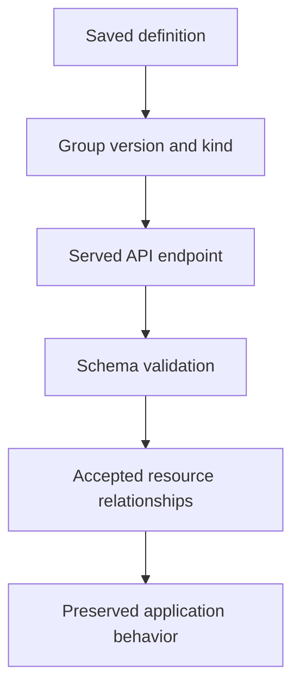

# Recognizing Deprecated APIs And Migrating Definitions

An old Deployment definition fails after a cluster upgrade, while the running application still exists. The failed submission and the stored workload describe different things. Discover the served interface before deciding that the application was deleted.

## Learning objectives

- Identify served resource groups and versions through discovery.
- Distinguish removed endpoints from schema and permission errors.
- Explain the behavior that a definition migration must preserve.

## Before you start

Use a shell on your own machine with the module playground running. A Pod is Kubernetes's unit for running one or more containers together. The environment provides the `probe` Deployment, which maintains application Pods, and the `starfleet` namespace, which groups these objects.

Read-only commands below use kubectl, the Kubernetes command-line tool. Select the private kubeconfig: the file that identifies this environment's cluster and credentials. The commands do not change the application.

## Recognizing Deprecated APIs and Migrating Definitions

The Kubernetes application programming interface (API) exposes resource types through versioned endpoints. A resource definition names an `apiVersion` and a `kind`, which together identify the schema and endpoint used for that object. API deprecation means a version is being phased out; removal means that endpoint is no longer served in the affected Kubernetes release.

## Separate Resource Identity From API Version

A resource such as Deployment can remain available through a supported API version after an older version disappears. Removing an old endpoint does not necessarily mean every stored object of that resource is immediately deleted. The ability to submit or retrieve an object through a particular version is a distinct question from its stored existence.

An API group organizes related resource types. The version follows that group in a grouped `apiVersion`, while core resources use an ungrouped version such as `v1`. Resource names used by the command-line client are generally plural endpoint names, whereas `kind` is the schema's type name. Mixing these concepts can make an error message difficult to interpret.

The cluster's served API resources are discoverable. The commands named `api-resources` and `api-versions` in `kubectl`, the Kubernetes command-line client, expose resource discovery and served group versions. Schema explanation is available through `explain`. Discovery indicates what the server serves; it does not guarantee that the current identity has permission to read or create every resource listed.

## A Migration Is More Than Renaming

Changing the version string can be necessary but insufficient. Supported fields, defaulting rules and required fields can change. A migration review compares the old definition with the replacement schema and preserves its intended behavior. A syntactically accepted object can still route traffic or select workloads differently after an incomplete transformation.

For an Ingress definition, backend representation and required path handling depend on the supported schema. The author must preserve the intended host, path, path type and Service port relationship rather than only updating the version line. For a Deployment, an explicit selector must agree with template labels; a version edit does not fix that independent relationship.

Generated definitions need attention too. A chart or overlay can keep producing an old API even after one manually edited file is corrected. Review the rendered output and the generator inputs together. Otherwise, the next release can reintroduce the unsupported endpoint.

## Distinguish Similar Failure Messages

A request for a kind through an unserved version can fail because the server has no matching resource endpoint. A request to an existing endpoint can instead fail schema validation because a field is unknown or required data is missing. A permission denial means the request reached a relevant authorization decision; it is not evidence that the API version is deprecated.

A custom resource can also be absent because its CustomResourceDefinition has not been installed or is not established. That is different from removing a built-in deprecated API. The diagnostic path starts by identifying the intended group, version and kind, then checking discovery and the exact server response.

Deprecation warnings should be treated as information for planned migration. An accepted request carrying a warning can still succeed today. Ignoring that warning until a cluster upgrade removes the endpoint turns a manageable maintenance task into a deployment failure.

## Verify The Intended Behavior

After transforming a definition, check schema compatibility, effective defaults and resource relationships. Then reason about the workload's observed state: matching Pods, intended routing and healthy reconciliation. Server-side validation checks acceptance under the cluster's schema and controls; it does not prove that application requests meet business expectations.

Keep the migration associated with the intended Kubernetes release and tool versions. Avoid assuming that a remembered retirement date applies forever. The useful maintenance skill is to discover current support, read the replacement contract and demonstrate preserved behavior, rather than memorize a list without checking its context.

## Inspect the mechanism

The application programming interface (API) server exposes resource endpoints through groups and versions. `apps/v1` identifies the group and version used by the fixture's Deployment. The kind identifies the object type, while the plural resource name identifies the endpoint used for requests. These names have related but different roles.

The `api-versions` command lists served group versions. `api-resources` lists resource endpoints and their scope. `explain` reads the schema for a selected type and field. Discovery can establish that an endpoint exists without granting your identity permission to use it. A migration must also preserve selectors, required fields and references; changing the version text alone cannot prove that.



A supported version is the beginning of a migration check, rather than its complete outcome.

<!-- astrona:playground:renew -->

Select the private cluster connection and inspect the live state from your host shell:

```sh
export KUBECONFIG="$(astrona kubeconfig ats-028-playground-010-01)"
if test "$(kubectl config current-context)" = "kind-astro-ats-028-playground-010-01"; then
  kubectl api-versions
  kubectl api-resources --api-group=apps
  kubectl explain deployment.spec.selector --api-version=apps/v1
else
  printf "Select this module's private kubeconfig before continuing.\n" >&2
fi
```

Locate `apps/v1`, the Deployment endpoint and the explanation of its selector. These are discovery and schema requests, not a workload update. Compare scope and version before interpreting a submission error. A removed endpoint, an invalid field and a forbidden action require different corrections; this healthy discovery result does not fabricate an obsolete API failure.

You can now discover supported interfaces and classify failures at the right boundary. Preserving the intended application requires reviewing schema changes and verifying the resulting resource relationships and behavior.

## Common pitfalls

> [!WARNING]
> Changing `apiVersion` alone is not a complete migration. Review schema differences, rendered output and application behavior, and distinguish unsupported endpoints from authorization or ordinary validation failures.
