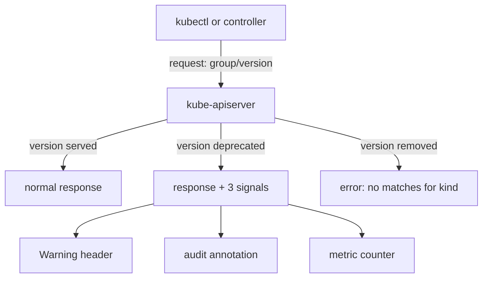

# Deprecation Policy And Server Signals

Teams often learn that an API version is gone when a deployment pipeline breaks. The Kubernetes project does not remove versions without notice, though. It follows a written deprecation policy and the API server tells every client when a deprecated version is used. This part explains the policy, the three signals the server sends, and the exact error a removed version produces.

## Stability levels and how long a version lives

Kubernetes labels each API version with a stability level, and the level is visible in the version string. An alpha version looks like `v1alpha1`. A beta version looks like `v1beta1`. A GA version, which means generally available and supported for production, looks like `v1`.

Alpha versions are experimental. They can change in incompatible ways or disappear without a deprecation period, and the API server leaves them switched off by default. Beta versions are tested and their features are intended to stay, but the schema can still change between beta versions. GA versions are stable: Kubernetes does not remove a GA version inside the same major version (`v1`) without first publishing a replacement.

The policy also sets a minimum lifetime once a version is announced as deprecated. A GA version must keep working for at least 12 months or 3 Kubernetes releases, whichever is longer. A beta version must keep working for at least 9 months or 3 releases, whichever is longer. An alpha version has no minimum. These numbers explain why a removal always appears in the release notes several releases before the version disappears.

Deprecation and removal are two different events. Deprecation is an announcement: the version still accepts requests, but a newer version exists and the old one will go away. Removal is the later release in which the API server stops serving that version at all.

## The three signals of a deprecated version

When a client sends a request to a deprecated version, the API server (`kube-apiserver`, the control plane component that handles every request) answers normally and adds three signals. Each signal serves a different reader.

The first signal is the `Warning` HTTP response header. kubectl prints it to standard error as a line that starts with `Warning:`, so a person sees it at the moment the command runs. The second signal is an audit annotation. If audit logging is enabled, the API server adds `k8s.io/deprecated: "true"` to the audit event for that request, so a cluster administrator can search the audit log for old clients. The third signal is a metric named `apiserver_requested_deprecated_apis`, which counts requests to deprecated versions. Its labels name the group, version, resource and the release in which the version is removed (`removed_release`).



The diagram shows the three outcomes the API server can produce for one request. A served version returns a normal response, a deprecated version returns the same response plus the three signals, and a removed version returns an error.

## See a deprecation warning

The playground runs Kubernetes v1.35.0. In that release the core `v1` Endpoints resource is deprecated in favor of EndpointSlice in the `discovery.k8s.io/v1` group. An Endpoints object lists the Pod addresses behind a Service, and an EndpointSlice stores the same list in a newer, scalable form. Reading Endpoints is therefore a request to a deprecated API.

Run a read-only request against it:

<!-- astrona:playground:renew -->

```sh
kubectl -n starfleet get endpoints probe
```

Look at standard error as well as the table. The Endpoints object is still returned, and a line that starts with `Warning:` names the deprecated resource and the replacement. The exact wording belongs to the Kubernetes release, so read the line instead of expecting a fixed text. If no warning appears, check the cluster version with `kubectl version` and confirm it is v1.33 or later.

Now read the replacement:

```sh
kubectl -n starfleet get endpointslices.v1.discovery.k8s.io
```

This request targets a supported version and prints no warning. The name `endpointslices.v1.discovery.k8s.io` has the form `resource.version.group`. Adding the version and group to the resource name tells kubectl which API version to read, which matters later when one resource exists in two versions.

## See a removed version fail

The `legacy-manifests` ConfigMap holds an Ingress written for `extensions/v1beta1`. An Ingress is an object that routes outside HTTP requests to Services. The `extensions/v1beta1` version of Ingress was removed in Kubernetes v1.22.

Extract the manifest from the ConfigMap. The backslash before the dot tells jsonpath that the key name `ingress.yaml` contains a dot:

```sh
kubectl -n starfleet get configmap legacy-manifests -o jsonpath='{.data.ingress\.yaml}' > ingress.yaml
cat ingress.yaml
```

Try to apply it with a server-side dry run, which sends the object to the API server for validation and stores nothing:

```sh
kubectl apply --dry-run=server -f ingress.yaml
```

The command fails. Look for the phrase `no matches for kind "Ingress" in version "extensions/v1beta1"` in the error. The API server is not saying that the Ingress is invalid. It is saying that this group and version no longer exist, so the `kind` cannot be mapped to any endpoint. A message of this form after an upgrade is the signal of a removed version.

Check what the cluster serves for the same resource:

```sh
kubectl api-versions | grep -E 'extensions|networking.k8s.io'
```

The list contains `networking.k8s.io/v1` and no `extensions/v1beta1`. The Ingress resource still exists. Only the old way to address it is gone. A definition that still uses that address must be found and changed.

## What the policy does not promise

The policy covers API versions. It does not cover the content of a version. When a replacement version has a different schema, a change of the `apiVersion` line alone is not enough, and the schema differences must be handled field by field.

The policy also treats stored objects separately from request endpoints. A removed version stops serving requests, but the cluster still holds the objects in a supported version. For example, an Ingress created years ago is read today through `networking.k8s.io/v1`. The signals in this part therefore point at clients and manifests that use old versions, and not at lost data.

You now know how long a version lives, how the API server announces a deprecation, and what a removal looks like. The open question is how to find every old definition before an upgrade, and discovery commands and the metric answer it.

## Common pitfalls

> [!WARNING]
> - A warning is not an error. A command that prints `Warning:` and succeeds still uses a deprecated version, and the same command can fail after the next upgrade.
> - `no matches for kind` means the group and version are not served. Do not look for a typing mistake in the fields; the version itself is the problem.
> - Do not apply a removed manifest to "see what happens" on a production cluster. Use `--dry-run=server` in a test cluster.
> - A deprecated version can still work for months. Do not treat a working command as proof that the manifest is safe for the next release.
