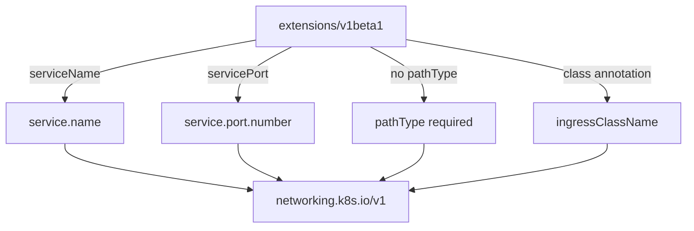

# Migrating Ingress And CronJob Definitions

An Ingress and a CronJob are two resources that many applications ship with, and both lost their old API versions in the same period. The two migrations are different in size. The Ingress changes its schema in three places, while the CronJob keeps its schema and only changes its `apiVersion`. This part migrates both and shows how to prove that each still does its job.

## What changed in the Ingress

An Ingress is an object that routes HTTP requests from outside the cluster to Services inside it. An Ingress controller, a separate program that you install, reads Ingress objects and does the routing. The versions `extensions/v1beta1` and `networking.k8s.io/v1beta1` were removed in Kubernetes v1.22, and `networking.k8s.io/v1` is the supported version.

Three things differ between the old and the supported schema:

- The backend uses `service.name` and `service.port.number` instead of `serviceName` and `servicePort`.
- Every path needs a `pathType`. The values are `Exact`, `Prefix` and `ImplementationSpecific`. `Prefix` matches by path elements split on `/`, so `/status` also matches `/status/ready`.
- The class that selects the controller is the field `spec.ingressClassName`. Older manifests used the annotation `kubernetes.io/ingress.class`.



The diagram shows each old field next to the field that replaces it. Every arrow is an edit you make by hand, because a version substitution cannot do any of them.

## Migrate the Ingress

Extract the old manifest from the ConfigMap and read it:

<!-- astrona:playground:renew -->

```sh
kubectl -n starfleet get configmap legacy-manifests -o jsonpath='{.data.ingress\.yaml}' > ingress.yaml
cat ingress.yaml
```

The Ingress is named `probe`, uses the class annotation `nginx` and sends the path `/` of the host `probe.starfleet.example` to the `probe` Service on port 80. Those four facts must stay the same after the migration.

First, see what the API server says when only the version changes. Save this as `ingress-without-pathtype.yaml`:

```yaml
apiVersion: networking.k8s.io/v1
kind: Ingress
metadata:
  name: probe
  namespace: starfleet
spec:
  ingressClassName: nginx
  rules:
  - host: probe.starfleet.example
    http:
      paths:
      - path: /
        backend:
          service:
            name: probe
            port:
              number: 80
```

Check it with a server-side dry run, which validates the object and stores nothing:

```sh
kubectl apply --dry-run=server -f ingress-without-pathtype.yaml
```

The command fails and names the field `pathType` as required. The exact message is written by the API server, so read it for the path of the field. The backend fields are already in the new form, and the failure shows that `pathType` has no default.

Now save the complete definition as `ingress-probe.yaml`. It adds `pathType: Prefix` and keeps the other values:

```yaml
apiVersion: networking.k8s.io/v1
kind: Ingress
metadata:
  name: probe
  namespace: starfleet
spec:
  ingressClassName: nginx
  rules:
  - host: probe.starfleet.example
    http:
      paths:
      - path: /
        pathType: Prefix
        backend:
          service:
            name: probe
            port:
              number: 80
```

Apply it and read back the fields that carry the meaning:

```sh
kubectl apply -f ingress-probe.yaml
kubectl -n starfleet get ingress probe -o jsonpath='{.spec.ingressClassName} {.spec.rules[0].http.paths[0].backend.service.name}{"\n"}'
```

The output shows `nginx probe`. The playground does not install an Ingress controller, so the object is stored but nothing routes traffic through it. The API server checks the schema and does not check that a controller exists, which is why the check here is on the stored fields.

## The CronJob keeps its schema

A CronJob is an object that creates a Job on a time schedule, written in cron syntax. A Job runs a Pod until it completes. The version `batch/v1beta1` was removed in Kubernetes v1.25, and the supported version is `batch/v1`. The fields `schedule`, `concurrencyPolicy`, `jobTemplate` and the history limits are the same in both versions, so the migration is the version line.

Extract the manifest, change the version with `sed` and apply the new file:

```sh
kubectl -n starfleet get configmap legacy-manifests -o jsonpath='{.data.cronjob\.yaml}' > cronjob.yaml
sed 's#batch/v1beta1#batch/v1#' cronjob.yaml > cronjob-v1.yaml
kubectl apply --warnings-as-errors -f cronjob-v1.yaml
```

The CronJob `beacon-report` runs every five minutes, so waiting for the schedule wastes time. Create a Job from the CronJob template instead and read its log:

```sh
kubectl -n starfleet create job beacon-report-test --from=cronjob/beacon-report
kubectl -n starfleet wait --for=condition=complete job/beacon-report-test --timeout=90s
kubectl -n starfleet logs job/beacon-report-test
```

The log shows the response of the `probe` Service, including the line `version=v1`. This proves that the Job template runs and reaches the application, which is the behavior that the version change must not break. The schedule was not tested by this command, but the stored `spec.schedule` can be compared with the old file.

You have migrated one resource that needed three field changes and one that needed none. In both cases the check read the live object, not the file you applied. The next resources, the autoscaler and the disruption budget, change their meaning in less obvious ways.

## Common pitfalls

> [!WARNING]
> - A manifest that passes `--dry-run=server` can still route nothing. Without an Ingress controller and a matching `ingressClassName`, the object is stored and ignored.
> - Do not keep the `kubernetes.io/ingress.class` annotation next to `ingressClassName`. Use the field, and remove the annotation.
> - `pathType: Prefix` matches whole path elements. A path `/status` does not match `/statuses`.
> - `kubectl create job --from=cronjob/...` runs the Job template once. It does not prove that the schedule expression is correct.
