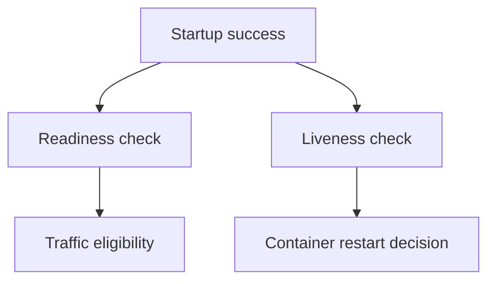

# Designing Startup, Readiness And Liveness Checks

The `probe` process can remain running while readiness removes it from Service traffic. A liveness failure would instead request a restart. Choosing the correct check prevents a temporary dependency failure from causing unnecessary process replacement.

## Learning objectives

- Distinguish startup, readiness and liveness decisions.
- Explain which component performs a container probe.
- Relate probe configuration to traffic eligibility and restart evidence.

## Before you start

Use a shell on your own machine with the module playground running. A Pod is Kubernetes's unit for running one or more containers together. The environment provides the `probe` Deployment, which maintains application Pods, and the `starfleet` namespace, which groups these objects.

Read-only commands below use kubectl, the Kubernetes command-line tool. Select the private kubeconfig: the file that identifies this environment's cluster and credentials. The commands do not change the application.

## Designing Startup, Readiness and Liveness Checks

A probe is a check performed by the kubelet, the Kubernetes node agent, to evaluate a container condition. Startup, readiness and liveness probes answer different questions. Their configured actions can change restart behavior or traffic eligibility, so using the same endpoint everywhere without considering its meaning can create avoidable failures.

## Separate Three Decisions

A startup probe allows a slow-starting application to finish initialization before its regular liveness and readiness checks proceed. If startup repeatedly fails under its configured threshold, the container can be restarted. While a startup probe has not succeeded, the other probes are suppressed for that container.

A readiness probe indicates whether the container is prepared to serve its role. A failure marks it unready and can remove the Pod from ordinary ready Service endpoints when the Pod's readiness conditions are not satisfied. Readiness failure does not by itself restart the container. This lets an application remain running while it is temporarily unable to accept useful traffic.

A liveness probe detects a condition for which restarting the container is an appropriate recovery. Repeated failure under its configured thresholds leads to the restart action. A dependent database being temporarily unreachable is often an unsuitable liveness condition: restarting every frontend does not necessarily repair the database and can remove otherwise useful recovery capacity.

## Choose A Check The Application Supports

An HTTP probe requests a path and interprets the response according to the probe's success rules. Hypertext Transfer Protocol (HTTP) response codes in the successful range describe the check result, but the endpoint must represent the intended condition. A web process serving a static health response while its request handler is broken can create misleading readiness.

A TCP probe tests a connection to a port. Transmission Control Protocol (TCP) connectivity can show that a listener accepts connections, but not that authentication or a meaningful business request succeeds. An executable probe runs a command inside the container and relies on its exit code. That command must exist and run with the container's effective environment and permissions.

A gRPC probe checks the supported gRPC health protocol, where configured and available. gRPC is a remote procedure call framework. Its probe settings and port support differ from assumptions that might be valid for other probe types. Select a check based on an actual application capability rather than inventing a universal health endpoint.

## Budget Time And Failure

`initialDelaySeconds` delays the first relevant check under its semantics. `periodSeconds` influences repeated checks, `timeoutSeconds` limits an individual attempt, and `failureThreshold` determines how many consecutive failures trigger the configured outcome. A `successThreshold` has applicable constraints and can influence readiness recovery.

A rough startup allowance can be reasoned about from the startup period and failure threshold, but scheduling and exact check timing should not be treated as an ideal stopwatch. The useful design question is whether realistic initialization fits the configured allowance without delaying failure detection excessively.

A timeout shorter than normal response latency creates false failures. A check that performs expensive dependency work at a high frequency can itself increase load. Health endpoints should be cheap enough for their frequency while meaningful enough to support the action they control.

## Diagnose A Restart Or Missing Endpoint

If `scout` restarts while warming its cache, compare the initialization time with its startup and liveness behavior. If it remains Running but receives no Service traffic, examine readiness and Service selection independently. A successful readiness probe does not fix an unrelated target-port mismatch.

Check which container owns the probe in a multi-container Pod. A helper's healthy process does not establish that the application container serves requests. Pod readiness can depend on several container conditions, so one unready participant can affect the workload's overall traffic eligibility.

Use the probe type, configured thresholds, event evidence and application behavior together. Changing every threshold until the problem disappears can hide a genuine defect. Correct the check's meaning or the application condition that it exposes, then preserve a useful distinction between startup delay, recoverable unavailability and restart-worthy failure.

## Inspect the mechanism

The fixture supplies `/ready` for traffic eligibility and `/health` for the application's health response. They are different endpoints even though both return success in the initial state. The kubelet performs configured container probes; the EndpointSlice controller then reflects Pod readiness in the Service backend information.

A startup probe delays regular readiness and liveness probing until startup succeeds. Readiness failure can leave the process running while removing ordinary ready traffic eligibility. Liveness failure can cause a restart after its failure threshold. Inspect the configured probes rather than assuming that the existence of `/health` means a liveness probe is already installed. A response path and a configured probe are separate objects of diagnosis.



Readiness and liveness use health evidence for different actions after the startup gate succeeds.

<!-- astrona:playground:renew -->

Select the private cluster connection and inspect the live state from your host shell:

```sh
export KUBECONFIG="$(astrona kubeconfig ats-028-playground-020-01)"
if test "$(kubectl config current-context)" = "kind-astro-ats-028-playground-020-01"; then
  kubectl -n starfleet get deployment probe -o jsonpath='{.spec.template.spec.containers[0].startupProbe}{"\n"}{.spec.template.spec.containers[0].readinessProbe}{"\n"}{.spec.template.spec.containers[0].livenessProbe}{"\n"}'
  kubectl -n starfleet get pods -l app=probe
  kubectl -n starfleet get endpointslices -l kubernetes.io/service-name=probe -o yaml
else
  printf "Select this module's private kubeconfig before continuing.\n" >&2
fi
```

Find which probe fields actually exist, then compare Pod readiness with endpoint conditions. Empty startup or liveness fields mean no such probe was declared. They do not prove that Kubernetes guessed an equivalent check. This inspection is read-only; it shows the starting contract before you deliberately change health conditions in practice.

You can now explain a missing ready endpoint separately from a restart. The right check measures a condition for which its configured action is useful, rather than treating every dependency failure as a reason to restart.

## Common pitfalls

> [!WARNING]
> Readiness controls eligibility, while liveness and failed startup checks can restart a container. Do not restart healthy frontends merely because a shared dependency is temporarily unavailable, or assume an open port proves useful application behavior.
