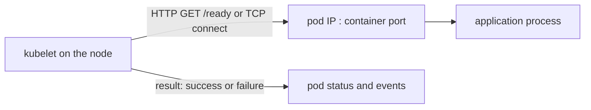

# HTTP And TCP Probes

A container can be running and still be useless: the process started, but it does not answer requests. Kubernetes cannot see inside the process, so it asks. The two handlers that ask over the network are `httpGet` and `tcpSocket`. They look similar in YAML, but they check very different things, and a wrong value in either one gives a pod that never becomes ready or a container that restarts again and again.

## Who runs a probe and where it goes

The kubelet runs every probe. The kubelet is the agent on each node that starts and watches the containers of the pods scheduled to that node. For an `httpGet` or `tcpSocket` probe, the kubelet opens a connection from the node to the pod IP address and the port you name. The request does not go through a Service, so a Service with a wrong `targetPort` never affects a probe.



Because the kubelet sends the request, the container does not need `curl` or a shell for these two handlers. The check works with an image that has only one binary.

## The httpGet handler

An `httpGet` probe sends an HTTP GET request. It succeeds when the response status code is at least 200 and below 400. Every other status code, a connection refused or a timeout counts as a failure. A redirect with status 301 or 302 therefore counts as a success.

The fields are `path` (default `/`), `port` (required, a number or the name of a container port), `scheme` (`HTTP` or `HTTPS`, default `HTTP`), `host` (default is the pod IP; rarely needed) and `httpHeaders` (a list of extra headers). Look at the `probe` Deployment in the playground, then print its readiness probe:

<!-- astrona:playground:renew -->

```sh
kubectl -n starfleet get deployment probe -o jsonpath='{.spec.template.spec.containers[0].readinessProbe}{"\n"}'
```

The output is one JSON object with an `httpGet` key that holds `path` and `port`. The port is the name `http`. A named port refers to an entry in the container's `ports` list, so the probe follows the port number if you change it there.

Ask the application directly what the three paths return. The `shuttle` pod has `wget`, and `-S` prints the response headers:

```sh
kubectl -n starfleet exec shuttle -- wget -S -q -O- -T 3 http://probe/ready
kubectl -n starfleet exec shuttle -- wget -S -q -O- -T 3 http://probe/nothing-here
```

The first request returns status 200. The second returns status 404, and `wget` exits with an error. A probe on `/nothing-here` would fail the same way. The application does not break; the probe asks for a path that does not exist.

## A wrong path in a real pod

Save this as `deployment-wrongpath.yaml`. It is a copy of a small web application whose readiness probe asks for `/readyz`, a path the application does not serve:

```yaml
apiVersion: apps/v1
kind: Deployment
metadata:
  name: wrongpath
  namespace: starfleet
spec:
  replicas: 1
  selector:
    matchLabels:
      app: wrongpath
  template:
    metadata:
      labels:
        app: wrongpath
    spec:
      containers:
        - name: web
          image: docker.io/library/python:3.13-alpine
          command: ["python", "/app/server.py"]
          ports:
            - name: http
              containerPort: 8080
          readinessProbe:
            httpGet:
              path: /readyz
              port: http
            periodSeconds: 3
          volumeMounts:
            - name: app
              mountPath: /app
              readOnly: true
      volumes:
        - name: app
          configMap:
            name: probe-code
```

Apply it:

```sh
kubectl apply -f deployment-wrongpath.yaml
```

Then check the result after about ten seconds:

```sh
kubectl -n starfleet get pods -l app=wrongpath
kubectl -n starfleet describe pod -l app=wrongpath
```

The pod shows `Running` but the `READY` column stays at `0/1`. In the events at the bottom of `describe`, look for a warning with the reason `Unhealthy` and the message `Readiness probe failed: HTTP probe failed with statuscode: 404`. That message names the handler, the check and the status code. A 404 means the application is up and the path is wrong. A `connection refused` message would mean nothing listens on that port.

Fix the path in place and watch the rollout finish:

```sh
kubectl -n starfleet patch deployment wrongpath --type=json -p '[{"op":"replace","path":"/spec/template/spec/containers/0/readinessProbe/httpGet/path","value":"/ready"}]'
kubectl -n starfleet rollout status deployment/wrongpath --timeout=120s
```

The patch changes the pod template, so the Deployment controller creates a new pod. The new pod becomes ready once the probe gets status 200.

## The tcpSocket handler

A `tcpSocket` probe opens a TCP connection to the pod IP and the port, and closes it at once. It succeeds when the connection opens. It sends no data and reads no data. The field `port` is required, and `host` is optional.

This is the right handler for a server that does not speak HTTP, such as a database or a message broker. It is a weaker check for a web application. A web server can accept connections while every request returns status 500, and a TCP probe reports success anyway.

Save this as `probe-tcp-patch.yaml`. It adds a liveness probe on the named port to the `wrongpath` Deployment:

```yaml
spec:
  template:
    spec:
      containers:
        - name: web
          livenessProbe:
            tcpSocket:
              port: http
            periodSeconds: 5
```

Apply it as a strategic merge patch and check the pod:

```sh
kubectl -n starfleet patch deployment wrongpath --patch-file probe-tcp-patch.yaml
kubectl -n starfleet rollout status deployment/wrongpath --timeout=120s
kubectl -n starfleet get pods -l app=wrongpath
```

The container keeps running because port 8080 accepts connections. Now change the port in the probe to 9090 and apply again. Nothing listens on 9090, so every attempt ends in `connection refused`. After three failures in a row (the default `failureThreshold`), the kubelet restarts the container. Check the `RESTARTS` column and the events: the message reads `Liveness probe failed: dial tcp ... connect: connection refused`.

You can now tell a wrong HTTP path (status 404, application up) from a wrong port (connection refused) by reading one event line. What is still open is the case where the check cannot be expressed as a network request at all, and the case where the application speaks gRPC.

## Common pitfalls

> [!WARNING]
> - **Probing a path the application does not serve.** A 404 is a failed probe. Request the path yourself first.
> - **Writing a port number twice.** When the container port changes, a numeric probe port stays old. Use the named port instead.
> - **Expecting a Service to help.** The kubelet connects to the pod IP and the container port. `targetPort` of a Service plays no role.
> - **Using `tcpSocket` for a web application and trusting it.** An open port does not prove that the application answers requests correctly.
> - **Using an HTTP endpoint that needs authentication.** The probe sends no credentials unless you add them in `httpHeaders`. A 401 or 403 response is a failure.
