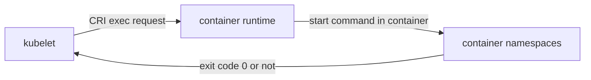

# Exec And gRPC Probes

The `httpGet` and `tcpSocket` handlers work from outside the container, over the network. Two other handlers exist for cases where a network request is not enough. The `exec` handler runs a command inside the container and reads its exit code. The `grpc` handler calls the standard gRPC health service of the application. Each has strict rules about what it needs from the image and from the application.

## The exec handler

An `exec` probe makes the container runtime start a command inside the running container. The command runs in the same namespaces and with the same user as the main process. The probe succeeds when the command exits with code 0. Any other exit code is a failure. The output of the command is ignored, except that the kubelet keeps a short part of it for the event message.

The only field is `command`, a list of strings. The command is not run in a shell. Pipes, redirects and `$VARIABLES` do nothing unless you call a shell yourself, for example `["sh", "-c", "test -f /tmp/ready"]`.



Because the command runs inside the image, the program it calls must exist there. An image without a shell fails a `sh -c` probe at once. A command that takes longer than `timeoutSeconds` counts as failed.

Look at what the playground application offers for an exec check. The container image is Python on Alpine, which has the BusyBox tools:

<!-- astrona:playground:renew -->

```sh
POD=$(kubectl -n starfleet get pod -l app=probe -o name | head -n 1)
kubectl -n starfleet exec "$POD" -- sh -c 'wget -q -T 2 -O /dev/null http://127.0.0.1:8080/health; echo exit=$?'
```

The output is `exit=0`. The command asks the application itself, from inside the container, over the loopback address. Now create the marker file that makes `/health` return 503 and repeat the command:

```sh
kubectl -n starfleet exec "$POD" -- touch /tmp/unhealthy
kubectl -n starfleet exec "$POD" -- sh -c 'wget -q -T 2 -O /dev/null http://127.0.0.1:8080/health; echo exit=$?'
```

The exit code is now 1, because `wget` returns a non-zero code for status 503. An `exec` probe that runs this command would fail the same way. Remove the marker again so the pod is healthy:

```sh
kubectl -n starfleet exec "$POD" -- rm /tmp/unhealthy
```

## An exec probe in a manifest

Save this as `probe-exec-patch.yaml`. It adds a readiness probe that tests a file and a liveness probe that calls the application:

```yaml
spec:
  template:
    spec:
      containers:
        - name: web
          readinessProbe:
            exec:
              command: ["sh", "-c", "wget -q -T 2 -O /dev/null http://127.0.0.1:8080/ready"]
            periodSeconds: 3
            timeoutSeconds: 3
```

Apply it to the `beacon` Deployment, which has no readiness probe yet:

```sh
kubectl -n starfleet patch deployment beacon --patch-file probe-exec-patch.yaml
kubectl -n starfleet rollout status deployment/beacon --timeout=120s
kubectl -n starfleet get deployment beacon -o jsonpath='{.spec.template.spec.containers[0].readinessProbe.exec.command}{"\n"}'
```

The output shows the command list. An exec probe starts a process for every attempt, so with a short period on many pods it costs more CPU than an HTTP probe. Use it when no network endpoint exists, for example to check that a file written by the application is recent.

## When an exec probe fails

Create a pod whose exec command does not exist, then read the event. Save as `pod-badexec.yaml`:

```yaml
apiVersion: v1
kind: Pod
metadata:
  name: badexec
  namespace: starfleet
spec:
  containers:
    - name: web
      image: docker.io/library/busybox:1.37.0
      command: ["sh", "-c", "sleep 3600"]
      readinessProbe:
        exec:
          command: ["/bin/does-not-exist"]
        periodSeconds: 3
```

```sh
kubectl apply -f pod-badexec.yaml
kubectl -n starfleet describe pod badexec | tail -n 12
```

The events show `Readiness probe errored` with a message that the executable file was not found, or a failure with a non-zero exit code. A probe that errors is not the same as an application that is unhealthy: the check itself is broken. Delete the pod with `kubectl -n starfleet delete pod badexec`.

## The grpc handler

Many services speak gRPC, a binary protocol on top of HTTP/2 that is not reachable with a plain HTTP GET. Kubernetes supports a built-in gRPC probe, stable since version 1.27. The kubelet calls the method `Check` of the gRPC Health Checking Protocol, defined in the service `grpc.health.v1.Health`. The probe succeeds when the response status is `SERVING`.

The fields are `port` (required, a number only; named ports are not allowed) and `service` (optional, the service name sent in the request; if you leave it out, the empty name asks about the overall server health). The application must implement the health service. If it does not, every probe fails with an `Unimplemented` error.

```yaml
livenessProbe:
  grpc:
    port: 50051
    service: orders.v1.Orders
  initialDelaySeconds: 5
  periodSeconds: 10
```

The handler uses plain gRPC without TLS and without authentication. It cannot send metadata or custom headers. A service that needs TLS or credentials on the health port cannot use this handler; use an `exec` probe with a client tool or expose a separate unencrypted health port.

## Choosing a handler

| Application offers | Handler | Success rule |
| --- | --- | --- |
| HTTP health endpoint | `httpGet` | Status 200 to 399 |
| Open port only (database, broker) | `tcpSocket` | Connection opens |
| gRPC health service | `grpc` | Status `SERVING` |
| Nothing on the network, or a custom check | `exec` | Exit code 0 |

## Common pitfalls

> [!WARNING]
> - **Expecting a shell in `exec`.** The command is a list, not a shell line. Use `sh -c` for pipes and variables, and make sure the image has `sh`.
> - **Reading exec output as the result.** Only the exit code counts.
> - **A named port in a `grpc` probe.** The field accepts a number only.
> - **A gRPC server without the health service.** The probe fails with `Unimplemented` even though the server works.
> - **A slow exec command.** The command must finish within `timeoutSeconds`, or the probe fails.
> - **Heavy exec probes on short periods.** Each attempt starts a process in the container.
