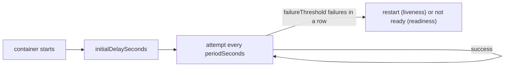

# Probe Timing Fields

Every probe has the same five timing fields. They decide when the first attempt happens, how often attempts repeat, how long one attempt may take, and how many results in a row change the state of the container. With the defaults, a failing liveness probe restarts a container after about 30 seconds. With careless values, a healthy container is restarted every minute.

## The five fields

| Field | Default | Minimum | Meaning |
| --- | --- | --- | --- |
| `initialDelaySeconds` | 0 | 0 | Seconds after the container starts before the first attempt |
| `periodSeconds` | 10 | 1 | Seconds between two attempts |
| `timeoutSeconds` | 1 | 1 | Seconds the kubelet waits for one attempt before it counts as a failure |
| `successThreshold` | 1 | 1 | Consecutive successes needed to change from failing to passing |
| `failureThreshold` | 3 | 1 | Consecutive failures needed to change from passing to failing |

`successThreshold` must be 1 for liveness and startup probes. Only readiness probes may use a higher value.

The kubelet keeps a counter per probe. A success resets the failure counter, and a failure resets the success counter. The state changes only when a counter reaches its threshold. One slow response among healthy ones does nothing.

## The arithmetic of a restart

For a liveness probe, the time from the first failing attempt until the restart is about `failureThreshold` times `periodSeconds`, plus the time for the last attempt to time out. With the defaults, the container fails on attempts at 0, 10 and 20 seconds, and the kubelet kills it at about 20 to 30 seconds.

The time before the first attempt matters more for new containers. A container that needs 45 seconds to listen, with `initialDelaySeconds: 5`, `periodSeconds: 5` and `failureThreshold: 2`, is killed at about 15 seconds. It restarts, needs 45 seconds again and is killed again. This loop is the `CrashLoopBackOff` status, even though the application has no bug.



## Liveness and readiness react differently

When the readiness probe fails `failureThreshold` times, the kubelet marks the container not ready. The endpoints controller then removes the pod IP address from the EndpointSlices of every Service that selects the pod. Traffic stops, and the container keeps running. When the probe succeeds `successThreshold` times, the pod returns to the endpoints.

When the liveness probe fails, the kubelet kills the container and applies the pod `restartPolicy`. The pod keeps its name and IP address. The `RESTARTS` column counts the restarts.

Look at the effect in the playground:

<!-- astrona:playground:renew -->

```sh
kubectl -n starfleet get pods -l app=probe
POD=$(kubectl -n starfleet get pod -l app=probe -o name | head -n 1)
kubectl -n starfleet exec "$POD" -- touch /tmp/not-ready
```

Wait about ten seconds, then list pods and EndpointSlices:

```sh
kubectl -n starfleet get pods -l app=probe
kubectl -n starfleet get endpointslices -l kubernetes.io/service-name=probe -o jsonpath='{range .items[*].endpoints[*]}{.addresses[0]}{" ready="}{.conditions.ready}{"\n"}{end}'
```

One pod shows `0/1` and an endpoint with `ready=false`. `RESTARTS` is still 0. Remove the marker so the pod returns:

```sh
kubectl -n starfleet exec "$POD" -- rm /tmp/not-ready
```

## timeoutSeconds in practice

An attempt that takes longer than `timeoutSeconds` is a failure, for every handler. The default of one second is short for an application under load, a cold cache or a slow disk. A probe that fails only under load makes things worse: the restart removes capacity at the moment capacity is needed. Raise `timeoutSeconds` when the check does real work, and keep the check cheap.

## Print the timing of a running probe

```sh
kubectl -n starfleet get deployment probe -o jsonpath='{.spec.template.spec.containers[0].livenessProbe}{"\n"}'
```

Fields that you did not set do not appear in the output of the Deployment, but the API server fills the defaults into the pod. Compare with the pod:

```sh
kubectl -n starfleet get pod "${POD#pod/}" -o jsonpath='{.spec.containers[0].livenessProbe}{"\n"}'
```

The pod output shows `timeoutSeconds`, `successThreshold` and `failureThreshold` with their default values.

## terminationGracePeriodSeconds on a probe

A probe can carry its own `terminationGracePeriodSeconds`. When the liveness probe kills a container, the container gets this many seconds to shut down after the stop signal, instead of the pod-level value. Set it low for a container that is known to be stuck, so the restart is quick. It is an advanced field; the pod-level value is enough in most cases.

## Sizing the values

1. Measure how long the application needs to become able to answer. Use the longest time you have seen, not the average.
2. Choose `periodSeconds` so a real failure is found in a time you accept, typically 5 to 10 seconds.
3. Choose `failureThreshold` of at least 3 so one slow answer does not cause a restart.
4. Choose `timeoutSeconds` larger than the slowest normal answer.
5. For readiness probes, use a short period. A pod should join and leave the Service quickly.
6. For liveness probes, use a longer period and a higher threshold. A restart is more costly than a short wait.

## Common pitfalls

> [!WARNING]
> - **Liveness probe with a short delay on a slow application.** The container is killed before it listens and loops in `CrashLoopBackOff`.
> - **`failureThreshold: 1` on a liveness probe.** One network hiccup restarts the container.
> - **Keeping the default `timeoutSeconds: 1` for a check that queries a database.** Under load the check fails and the pod restarts.
> - **Confusing the two effects.** A failing readiness probe never restarts a container. A failing liveness probe always does.
> - **Setting `successThreshold` above 1 on a liveness probe.** The API server rejects it.
