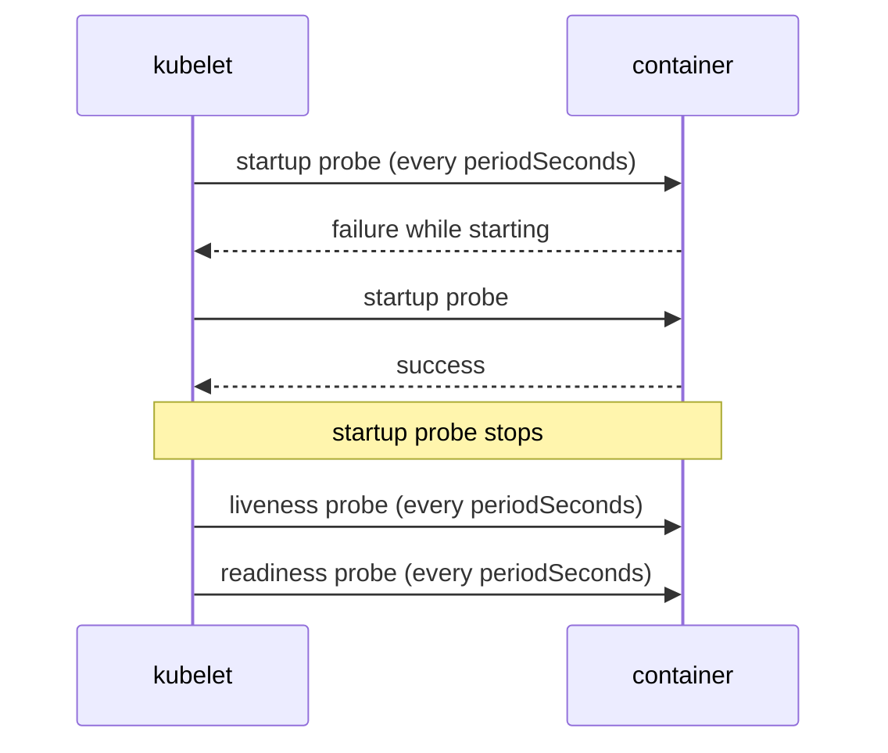

# Startup Probes

Some applications need a long time to start: they load a large cache, run database migrations or warm up a runtime. A liveness probe cannot tell the difference between an application that is still starting and one that is stuck. If you make the liveness delay long enough for the slowest start, a real failure later takes just as long to detect. The startup probe solves this by guarding the start phase with its own, longer budget.

## What a startup probe does

A startup probe uses the same handlers and the same five timing fields as the other probes. While it runs, the kubelet does not run the liveness and readiness probes of that container. When the startup probe succeeds once, it stops for the rest of the container's life, and the other two probes begin.

If the startup probe fails `failureThreshold` times in a row, the kubelet kills the container and applies the `restartPolicy`, the same as a liveness failure. The `successThreshold` must be 1.



## The startup budget

The time the application gets to start is `failureThreshold` times `periodSeconds`, plus `initialDelaySeconds`. A startup probe with `periodSeconds: 5` and `failureThreshold: 24` gives the container 120 seconds. If the application is ready after 40 seconds, the startup probe succeeds at the next attempt after 40 seconds, so a fast start is not delayed by the large budget.

After the startup probe succeeds, the liveness probe can be fast, for example `periodSeconds: 5` and `failureThreshold: 3`. A deadlock after the start is found in about 15 seconds, while the start itself had 120 seconds.

## A slow application, step by step

The `slow` Deployment in the playground waits 30 seconds before it listens. See what its pod does:

<!-- astrona:playground:renew -->

```sh
kubectl -n starfleet get pods -l app=slow
kubectl -n starfleet logs -l app=slow --tail=5
```

For the first seconds the pod shows `0/1` and the log is empty, because the server prints its first line only after the delay. The readiness probe fails with `connection refused` until then.

Now create a liveness probe that is too eager. Save as `slow-liveness-patch.yaml`:

```yaml
spec:
  template:
    spec:
      containers:
        - name: web
          livenessProbe:
            httpGet:
              path: /health
              port: http
            initialDelaySeconds: 5
            periodSeconds: 5
            failureThreshold: 2
```

```sh
kubectl -n starfleet patch deployment slow --patch-file slow-liveness-patch.yaml
sleep 60
kubectl -n starfleet get pods -l app=slow
kubectl -n starfleet describe pod -l app=slow | grep -E 'Unhealthy|Killing|Restart'
```

The pod shows a growing `RESTARTS` count and, soon, `CrashLoopBackOff`. The events show `Liveness probe failed: ... connection refused` followed by `Container web failed liveness probe, will be restarted`. The application is fine; the probe is early. At 5 plus 2 times 5, about 15 seconds, the container is killed, and the application needs 30.

## The fix: add a startup probe

Save as `slow-startup-patch.yaml`:

```yaml
spec:
  template:
    spec:
      containers:
        - name: web
          startupProbe:
            httpGet:
              path: /health
              port: http
            periodSeconds: 5
            failureThreshold: 24
```

```sh
kubectl -n starfleet patch deployment slow --patch-file slow-startup-patch.yaml
kubectl -n starfleet rollout status deployment/slow --timeout=180s
kubectl -n starfleet get pods -l app=slow
```

The new pod needs about 30 seconds, then becomes ready, with `RESTARTS` at 0. The liveness probe does not run during the start, so its `initialDelaySeconds` is no longer needed. You can set it back to 0.

Check the budget from the live object:

```sh
kubectl -n starfleet get deployment slow -o jsonpath='{.spec.template.spec.containers[0].startupProbe.failureThreshold}{" x "}{.spec.template.spec.containers[0].startupProbe.periodSeconds}{"\n"}'
```

The output is `24 x 5`, a budget of 120 seconds.

## When the startup budget is too small

Set `failureThreshold` to 3 and apply again. The budget is 15 seconds, the application needs 30, and the container is killed during the start. The event text is `Startup probe failed`. Use this signature to recognize an undersized startup probe: the restart happens before the application ever answered, and the logs of the previous container are empty or show only the beginning of the start.

```sh
kubectl -n starfleet get events --field-selector reason=Unhealthy --sort-by=.lastTimestamp | tail -n 5
```

## Choosing between startup probe and initial delay

| Approach | Behavior | Use when |
| --- | --- | --- |
| `initialDelaySeconds` on liveness | Fixed wait, then the normal period | The start time is short and stable |
| Startup probe | Polls until the first success, with a large budget | The start time is long or varies |

With `initialDelaySeconds`, a start that is faster than the delay still waits the full delay, and a start that is slower than the delay is killed. A startup probe has neither problem, because it detects the first success.

## Common pitfalls

> [!WARNING]
> - **A budget below the real start time.** The container is killed during the start and the loop looks like a crash.
> - **Expecting liveness to run during the startup probe.** It does not. A hang during the start is detected only by the startup budget running out.
> - **Using the startup probe with a handler that succeeds too early.** A `tcpSocket` probe may succeed when the port opens, before the application can serve.
> - **Leaving a long `initialDelaySeconds` on liveness after adding a startup probe.** It delays the first liveness check for no reason.
> - **Setting `successThreshold` above 1.** The API server rejects it for startup probes.
