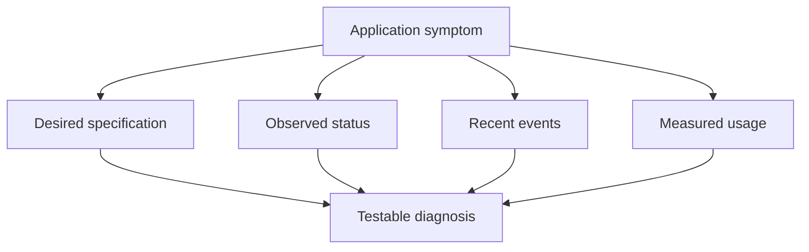

# Choosing Diagnostic Evidence With kubectl

The `probe` Deployment requests two replicas, its status reports current availability, and metrics report recent resource usage. These are three different observations. Choosing the right one makes a troubleshooting claim precise.

## Learning objectives

- Distinguish desired specification, observed status, events and metrics.
- Select kubectl inspection commands for a concrete symptom.
- Explain why current usage does not replace scheduling requests.

## Before you start

Use a shell on your own machine with the module playground running. A Pod is Kubernetes's unit for running one or more containers together. The environment provides the `probe` Deployment, which maintains application Pods, and the `starfleet` namespace, which groups these objects.

Read-only commands below use kubectl, the Kubernetes command-line tool. Select the private kubeconfig: the file that identifies this environment's cluster and credentials. The commands do not change the application.

## Choosing Diagnostic Evidence With kubectl

`kubectl` is the Kubernetes command-line client. It sends requests to the application programming interface (API) server using a selected cluster, identity and namespace context. Its built-in inspection commands expose different kinds of evidence. Choosing the right evidence is part of diagnosis; a large collection of unrelated output can obscure the condition that actually prevents an application from working.

## Confirm The Observation Scope

A kubeconfig file describes access contexts and credentials or credential mechanisms. The current context selects the cluster and related defaults used for a request. An explicit namespace selection or the context's namespace affects namespaced resource queries. Looking at the wrong context can produce a convincing description of the wrong application.

Resource names are also scoped. A Pod named `scout` in one namespace is not the same object as a Pod with that name elsewhere. Labels can select a group of resources, but the meaning of that group depends on the actual label values and resource types queried. A label selector does not itself establish controller ownership.

Permissions constrain observations. A forbidden response means the current identity cannot perform the requested action under the relevant authorization decision. It does not establish that the requested resource is absent. A successful discovery request also does not grant access to every discovered resource.

## Compare Spec, Status And Events

A resource's specification expresses desired state. Its status records controller or system observations for that object. The `get` command can show selected fields or a complete resource representation. A Deployment asking for three replicas can therefore be distinguished from having three available replicas.

The `describe` command presents a human-readable view of configuration, status and related events. Events can explain scheduling, image preparation and health-check failures. They are time-limited observations rather than an exhaustive permanent audit history, and repeated events may be summarized. Absence of an old event is not proof that its condition never occurred.

Field-specific output helps compare precise properties. JSONPath is a query notation that can select data from the structured response, while JSON is JavaScript Object Notation. Distinguish an empty selected field from a failed request or a query written against the wrong structure. Formatting tools do not change the server's underlying resource semantics.

## Resource Use Is A Separate Signal

The `top` command reports resource metrics through an available metrics service. It is not simply another view of Pod specification fields. The cluster must supply the relevant metrics API, and the observer needs access. A failure to obtain metrics can occur while the application itself is running normally.

Measured usage, declared requests and configured limits are different quantities. A low current CPU observation does not show that the Pod can be scheduled with a very large request. CPU means central processing unit. A workload can also have brief peaks that are not represented by one measurement snapshot.

Metrics answer a timing-sensitive question about consumption. Use them alongside requests, limits, restart history and application symptoms. Increasing a memory limit without knowing why a process grows can postpone failure instead of correcting a leak or unsuitable application sizing.

## Choose The Next Diagnostic Layer

If a Pod is Pending, status and events about scheduling or dependencies are usually more useful than application logs that do not yet exist. If it is repeatedly restarting, termination state and the previous container instance's logs can explain what happened. If it is Running but unreachable, readiness, Service endpoints, ports and network controls need attention.

The `logs` command retrieves supported container logs, while `exec` starts a process in a running container. They are different subresources and can require different permissions. An image without a shell cannot be inspected through a shell command merely because the Pod exists. A debugging container or copied workload can provide another method where supported and authorized, but it changes the investigation context.

For a report frontend returning errors, begin with the specific failing path and time, identify the affected workload and compare its intended and observed state. Select each next observation to test a hypothesis. This creates an explainable diagnostic sequence instead of treating command familiarity as evidence of the cause.

## Inspect the mechanism

`get` reads structured objects. `describe` combines their fields and related events into a human-readable view. `top` retrieves recent usage through the metrics API rather than reading resource requests from the Pod specification. Each command answers a different question, so collecting them without a hypothesis can still leave the cause unclear.

For example, a Pod can request more memory than any node can allocate while currently using almost none, because it has not started. Low observed usage elsewhere does not make that request schedulable. Conversely, a running Pod can approach its memory limit while its declared request remains small. Metrics need a sampling window and cannot reconstruct every short-lived peak.



Different evidence types support a diagnosis only when they are connected to the same symptom and time.

<!-- astrona:playground:renew -->

Select the private cluster connection and inspect the live state from your host shell:

```sh
export KUBECONFIG="$(astrona kubeconfig ats-028-playground-030-01)"
if test "$(kubectl config current-context)" = "kind-astro-ats-028-playground-030-01"; then
  kubectl -n starfleet get deployment probe
  kubectl -n starfleet describe deployment probe
  kubectl -n starfleet top pods
else
  printf "Select this module's private kubeconfig before continuing.\n" >&2
fi
```

Compare desired and available replica fields with event evidence and measured usage. This playground includes Metrics Server, the component that supplies resource metrics, but early sampling can still be unavailable. A metrics error is evidence about that observation path, not proof that the application has failed. Do not substitute a request or limit value for missing measured usage.

You can now select an observation by the question it answers. Correct scope, permissions and timing remain necessary before interpreting any command result as evidence of the application cause.

## Common pitfalls

> [!WARNING]
> Correctly formatted output from the wrong context is still the wrong evidence. Distinguish desired state, observed status, temporary events and measured usage, and check permissions before interpreting a missing observation.
