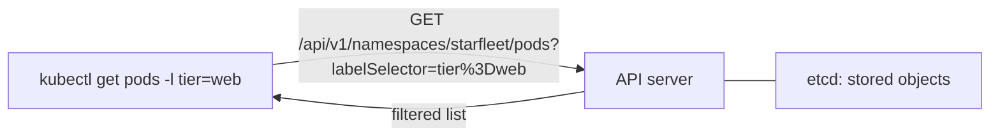

# Label And Field Selectors

Every Kubernetes object can carry labels: key and value pairs in `metadata.labels`. A selector is a query over those labels, or over a small set of built-in fields. The query is sent to the API server, which is the cluster component that stores and serves objects. The API server evaluates the selector and returns only the matching objects, so a narrow selector also reduces the amount of data sent to `kubectl`.

## Where selectors run



The flag `-l` (long form `--selector`) becomes the query parameter `labelSelector`. The flag `--field-selector` becomes `fieldSelector`. Both are part of the request URL, which you can see with `kubectl get pods -l tier=web -v=6`.

Open the playground and list the pods with their labels:

<!-- astrona:playground:renew -->

```sh
kubectl -n starfleet get pods --show-labels
```

The `LABELS` column shows `app`, `tier`, `env` and the `pod-template-hash` label that the Deployment adds. Labels do not describe themselves: they are only text that someone wrote in the pod template.

## Equality-based label selectors

An equality-based requirement has the form `key=value`, `key==value` or `key!=value`. Several requirements are separated by commas and are combined with AND: every requirement must be true.

```sh
kubectl -n starfleet get pods -l tier=web
kubectl -n starfleet get pods -l tier=web,env=prod
kubectl -n starfleet get pods -l tier!=worker
```

The first command returns the pods of `probe` and `scout`. The second returns only the pods of `probe`, because the pod of `scout` has `env=staging`. The third returns every pod whose `tier` is not `worker`. This includes pods that have no `tier` label at all, such as `shuttle`. A negative requirement matches a missing key.

There is no OR between requirements in the comma form. To express OR for one key, use a set-based requirement.

## Set-based label selectors

A set-based requirement uses the operators `in`, `notin` and a bare key to test existence. Quote the expression so that the shell does not interpret the parentheses.

```sh
kubectl -n starfleet get pods -l 'env in (prod,staging)'
kubectl -n starfleet get pods -l 'tier notin (worker)'
kubectl -n starfleet get pods -l tier
kubectl -n starfleet get pods -l '!tier'
```

`env in (prod,staging)` is true when the value of `env` is `prod` or `staging`. `tier` alone is true when the key exists, whatever its value. `!tier` is true when the key does not exist, so it returns `shuttle`. `notin` also matches objects that lack the key.

## Selectors across namespaces

Selectors work inside the namespace chosen with `-n`. To search every namespace add `-A` (short for `--all-namespaces`):

```sh
kubectl get pods -A -l app=shuttle
kubectl get pods -A --show-labels
```

Without `-n` or `-A`, `kubectl` uses the namespace of the current context. If that is `default`, a selector that matches nothing prints `No resources found in default namespace.` This message is the most common sign that the namespace was wrong and the selector was right.

## Field selectors

A field selector filters on a field of the object, not on a label. It supports equality only: `=`, `==` and `!=`. Which fields are allowed depends on the resource type. Every resource supports `metadata.name` and `metadata.namespace`. Pods add `spec.nodeName`, `spec.restartPolicy`, `spec.schedulerName`, `spec.serviceAccountName`, `status.phase` and `status.podIP`.

```sh
kubectl -n starfleet get pods --field-selector=status.phase=Running
kubectl -n starfleet get pods --field-selector=status.phase=Succeeded
kubectl -n starfleet get pods --field-selector=status.phase!=Running
kubectl -n starfleet get pods --field-selector=metadata.name=shuttle
```

The second command returns the pod of the finished Job `report-job`. The third returns that pod too, because its phase is not `Running`. Several field selectors can be combined with a comma, and field selectors can be combined with `-l` in the same command.

An unsupported field is rejected by the API server:

```sh
kubectl -n starfleet get pods --field-selector=spec.containers.image=nginx
```

The error reads `field label not supported: spec.containers.image`. A selector on any other field has to be done on the client side, with JSONPath or `jq`, as the next part shows.

## Selectors in actions

The same `-l` flag works with commands that change objects, which makes one selector both the query and the target:

```sh
kubectl -n starfleet label pods -l tier=web,env=prod reviewed=true
kubectl -n starfleet get pods -L reviewed
kubectl -n starfleet label pods -l reviewed reviewed-
```

`-L reviewed` adds a column with the value of the label. A key followed by a dash removes the label. Check the selection with `get` before you run `delete`, `label` or `annotate` with a selector.

## Selectors and Services

A Service selects its pods with a label selector too, in `spec.selector`. That selector supports only equality requirements joined by AND, written as a map. The set-based forms are not available in a Service. If a Service has no endpoints, compare its selector with the pod labels:

```sh
kubectl -n starfleet get service probe -o jsonpath='{.spec.selector}{"\n"}'
kubectl -n starfleet get pods -l app=probe
kubectl -n starfleet get endpointslices -l kubernetes.io/service-name=probe
```

If the first two agree and the endpoint slice lists addresses, the selection is correct and the problem is elsewhere.

## Common pitfalls

> [!WARNING]
> - **Forgetting the namespace.** A correct selector in the wrong namespace returns nothing.
> - **Unquoted set expressions.** `-l env in (prod,staging)` is split by the shell. Put the whole expression in quotes.
> - **Expecting OR with commas.** Commas mean AND. Use `in (a,b)` for OR on one key.
> - **Trusting `!=`.** It also matches objects without the key.
> - **Using a field selector on an unsupported field.** Only a few fields per type are indexed.
> - **Acting on a selector you did not preview.** Run the same `-l` with `get` first.
