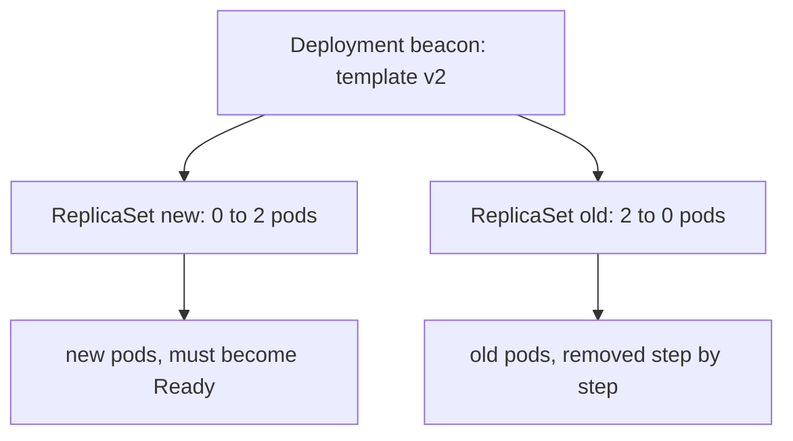

# Rollouts, Revisions And Rollback

A Deployment does not run pods itself. It owns ReplicaSets, and each ReplicaSet owns the pods of one pod template. When you change the pod template of a Deployment, for example its image or an environment variable, the Deployment controller creates a new ReplicaSet for the new template and moves pods from the old ReplicaSet to the new one. This process is a rollout. A change that does not touch the pod template, such as scaling, does not create a rollout.

## How the controller moves pods



Two fields in `spec.strategy.rollingUpdate` set the pace. `maxSurge` is how many pods above the desired count may exist during the update. `maxUnavailable` is how many pods below the desired count may be unavailable. Both default to 25 percent. A percentage is rounded up for `maxSurge` and down for `maxUnavailable`. With 2 replicas, `maxSurge` is 1 and `maxUnavailable` is 0. The controller therefore starts one new pod and removes an old pod only after the new pod is Ready. If the new pod never becomes Ready, the old pods stay in service and the rollout is stuck, not an outage.

## Reading a rollout

Open the playground and trigger a rollout:

<!-- astrona:playground:renew -->

```sh
kubectl -n starfleet set env deployment/beacon VERSION=v2
kubectl -n starfleet rollout status deployment/beacon
```

`rollout status` watches the Deployment until it completes. It prints lines such as `Waiting for deployment "beacon" rollout to finish: 1 old replicas are pending termination...` and ends with `deployment "beacon" successfully rolled out`. Its exit code is 0 on success and non-zero on failure or timeout, so it can gate a script. Add `--timeout=60s` to stop waiting after a limit.

The status fields behind that output are in the Deployment:

```sh
kubectl -n starfleet get deployment beacon -o jsonpath='{.status}{"\n"}'
kubectl -n starfleet get replicasets -l app=beacon
```

Compare `replicas`, `updatedReplicas`, `readyReplicas` and `availableReplicas`. A rollout is complete when all four equal the desired count and no old pods remain. The ReplicaSet list shows the new ReplicaSet with 2 pods and the old one with 0.

## Progress deadline

`spec.progressDeadlineSeconds` (default 600) is the time the controller waits for a rollout to make progress. When it passes, the Deployment gets the condition `Progressing=False` with the reason `ProgressDeadlineExceeded`. The controller does not roll back by itself and it does not stop trying. Read the condition:

```sh
kubectl -n starfleet get deployment beacon -o jsonpath='{.status.conditions[*].reason}{"\n"}'
```

## Revision history

Each ReplicaSet that a Deployment creates is a revision. The Deployment keeps old ReplicaSets, scaled to 0, up to `spec.revisionHistoryLimit` (default 10). They are the data that makes a rollback possible.

```sh
kubectl -n starfleet rollout history deployment/beacon
kubectl -n starfleet rollout history deployment/beacon --revision=2
```

The list shows `REVISION` and `CHANGE-CAUSE`. The second command prints the pod template of one revision, which is how you read an old image or environment value. The `CHANGE-CAUSE` column is empty unless the annotation `kubernetes.io/change-cause` is set on the Deployment when the revision is created. Set it with:

```sh
kubectl -n starfleet annotate deployment/beacon kubernetes.io/change-cause="set VERSION to v2" --overwrite
```

The `--record` flag that set this annotation automatically is deprecated, so write the annotation yourself. The text is copied to the revision when the next revision is created, and it is a free text field: it records intent, not proof.

## Rolling back

`rollout undo` makes the Deployment use the template of an earlier revision:

```sh
kubectl -n starfleet rollout undo deployment/beacon
kubectl -n starfleet rollout undo deployment/beacon --to-revision=1
kubectl -n starfleet rollout status deployment/beacon
```

Without `--to-revision`, the target is the revision just before the current one. The controller does not go back in time: it scales the old ReplicaSet up and the current one down, and the old revision receives a new, higher revision number. After a rollback, the history shows no separate entry for the revision you came back from, because it became the current one.

## Pause and resume

`kubectl rollout pause` stops the controller from starting a rollout when the template changes. You can then make several changes and apply them as one rollout with `kubectl rollout resume`:

```sh
kubectl -n starfleet rollout pause deployment/beacon
kubectl -n starfleet set env deployment/beacon VERSION=v3
kubectl -n starfleet set resources deployment/beacon --requests=cpu=30m
kubectl -n starfleet rollout resume deployment/beacon
```

While paused, `rollout status` reports that the deployment is paused. A rollback with `undo` is refused until the Deployment is resumed.

## Restart without a change

`kubectl rollout restart deployment/beacon` adds the annotation `kubectl.kubernetes.io/restartedAt` to the pod template. This is a template change, so it creates a new ReplicaSet and replaces every pod with the normal rolling pace. It is the supported way to restart all pods of a Deployment, for example after a ConfigMap change that the application reads only at start.

## Common pitfalls

> [!WARNING]
> - **Expecting automatic rollback.** The Deployment keeps trying until you act.
> - **Reading "stuck" as "down".** With `maxUnavailable` of 0, old pods keep serving.
> - **Setting `revisionHistoryLimit: 0`.** No old ReplicaSets remain and `undo` is impossible.
> - **Trusting `CHANGE-CAUSE`.** It is text that a person set. Read `--revision=N` for facts.
> - **Scaling and expecting a revision.** Only a pod template change creates one.
