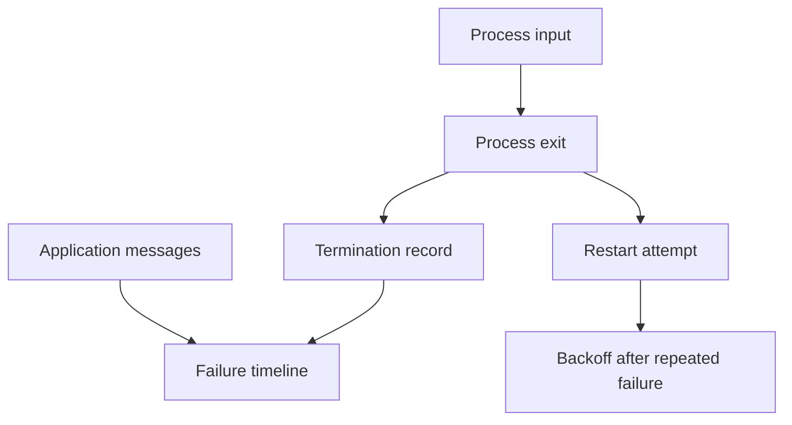

# Logs, Exits And Crash Loops

A container exits because it cannot read required configuration. Kubernetes retries it and later displays a crash-loop backoff. The retry delay describes Kubernetes's response, while the first exit and its inputs explain the failure.

## Learning objectives

- Correlate current and previous container state with logs.
- Distinguish an exit cause from restart backoff.
- Construct a failure timeline without exposing confidential data.

## Before you start

Use a shell on your own machine with the module playground running. A Pod is Kubernetes's unit for running one or more containers together. The environment provides the `probe` Deployment, which maintains application Pods, and the `starfleet` namespace, which groups these objects.

Read-only commands below use kubectl, the Kubernetes command-line tool. Select the private kubeconfig: the file that identifies this environment's cluster and credentials. The commands do not change the application.

## Logs, Exits and Crash Loops

The `scout` process exits immediately after reading its configuration. Kubernetes can restart it, but repeated restarts do not fix a missing setting. Application debugging focuses on what the process did, what inputs it received and which dependencies it needed.

A log is a record emitted by software about an event or condition. Logs can include timestamps, request identifiers and error details. A termination record can provide an exit code and reason. Read these together: an error message about a missing setting and an immediate nonzero exit support a different explanation from a memory-limit termination.

A crash loop describes repeated process termination and restart with backoff delays. The displayed backoff reason explains the retry behavior, not the application's original failure. The previous container's logs can be important when the current attempt has barely started. Some logging systems retain those records; local access can depend on runtime retention.

Logs should not be treated as infallible. A final error can be a consequence of an earlier failed dependency, and absent logs do not prove no error occurred. The process may have terminated before logging, written elsewhere or lost buffered output. Check the timeline around configuration and release changes.

Changing many settings at once weakens the diagnosis. A useful hypothesis predicts the evidence and a focused correction. If the address is missing, restoring the expected configuration should allow initialization to pass that point. If it is memory exhaustion, the application usage and enforced boundary need examination.

Protect sensitive data while collecting evidence. Record enough context to reproduce the symptom without exposing tokens, passwords or customer data. Debugging should clarify behavior without creating another incident through diagnostic output.

## Constructing A Failure Timeline

Suppose a new `scout` container starts, reads settings, reports an invalid database address and exits. Its restart count rises. The time of the release, the first log error and the termination record support a startup configuration hypothesis. The backoff delay is a later control response, not the first failing event.

Compare this with memory termination. The final application log might be ordinary because the runtime terminates the process when the resource boundary is exceeded. An absence of a logged application exception does not invalidate that termination evidence. Exit codes and reasons need interpretation alongside the runtime and resource settings.

Logs can also be buffered or written to a destination other than the standard streams collected by the platform. A process killed quickly can lose unwritten messages. Central log retention helps preserve historical attempts, but it can fail independently. Always distinguish missing evidence from evidence that the application succeeded.

## Hypotheses Should Predict A Result

A useful hypothesis states which input or condition caused the failure and what correction would change. “The database address is invalid” predicts a connection-related startup error and progress after a valid value reaches the process. “The application exhausts its memory allowance” predicts termination near the boundary and requires examining usage, leaks and sizing.

Changing the image, credentials, memory and probe at once can make the application run without identifying which change mattered. It can also conceal a new weakness, such as disabled health checks or excessive permissions. Prefer a focused correction supported by evidence and verify the expected transition.

Keep the diagnostic record safe to share. Replace sensitive values with descriptions of their role, retain useful timestamps and include the relevant process or container identity. A strong explanation can demonstrate a configuration fault without copying production credentials into a public issue.

## Inspect the mechanism

Container status separates the current state from the last terminated state and records a restart count. A currently running attempt can coexist with an earlier failed instance. The log stream you select must belong to the relevant container and attempt if it is to explain that termination.

An exit reason and code provide runtime evidence. Application logs provide the process's perspective, which may be incomplete if output was buffered or the process was killed. A memory termination can leave no final application exception. Compare termination reason, resource settings and the preceding messages rather than treating the last line as a universal cause.



Backoff follows failed attempts; it is not the original application event that caused the exit.

<!-- astrona:playground:renew -->

Select the private cluster connection and inspect the live state from your host shell:

```sh
export KUBECONFIG="$(astrona kubeconfig ats-028-playground-040-01)"
if test "$(kubectl config current-context)" = "kind-astro-ats-028-playground-040-01"; then
  kubectl -n starfleet get pods -l app=probe -o jsonpath='{range .items[*]}{.metadata.name}{" "}{.status.containerStatuses}{"\n"}{end}'
  kubectl -n starfleet logs deployment/probe -c probe --tail=20 --timestamps
else
  printf "Select this module's private kubeconfig before continuing.\n" >&2
fi
```

Read state, lastState and restartCount before interpreting the selected logs. The healthy baseline may have no terminated instance and no startup message; neither requires invented crash output. `--tail` bounds records, and `--timestamps` adds recorded times. The Deployment log shortcut chooses a Pod, so use an explicit Pod name when investigating a specific failed replica.

You can now connect a restart to the relevant process instance and evidence. A focused correction must change the cause, while repeated restarts alone can reproduce the same failure indefinitely.

## Common pitfalls

> [!WARNING]
> A crash-loop delay is not the root cause. The last log line may be a consequence, and restarting without changing the cause can repeat the same failure.
