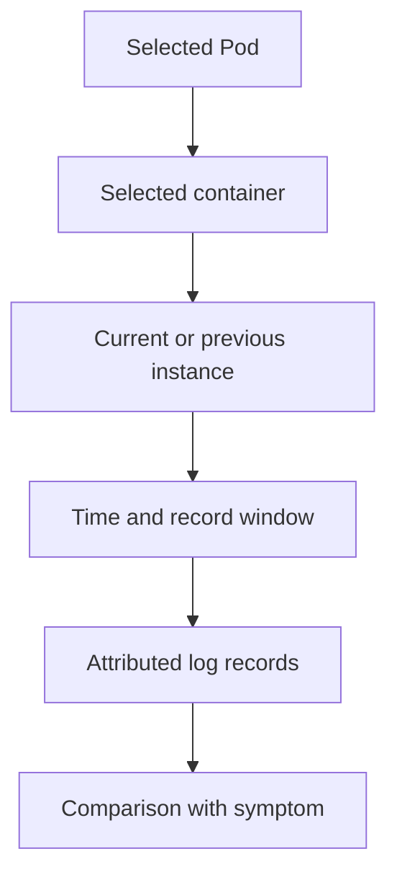

# Selecting The Right Container Log And Time Window

During a rollout, two `probe` replicas can emit messages from different versions. A Deployment-level log shortcut can show only one selected Pod. Useful log diagnosis starts with an explicit Pod, container and time window.

## Learning objectives

- Choose the container and lifecycle instance relevant to a symptom.
- Bound and timestamp a log observation.
- Explain the limits of previous-container and replaced-Pod history.

## Before you start

Use a shell on your own machine with the module playground running. A Pod is Kubernetes's unit for running one or more containers together. The environment provides the `probe` Deployment, which maintains application Pods, and the `starfleet` namespace, which groups these objects.

Read-only commands below use kubectl, the Kubernetes command-line tool. Select the private kubeconfig: the file that identifies this environment's cluster and credentials. The commands do not change the application.

## Selecting The Right Container Log and Time Window

Container logs provide text emitted by a container process through the supported logging path. They can describe application events and errors, but they do not automatically include every file the process writes. Useful diagnosis depends on selecting the correct Pod, container, instance and time window before interpreting the text.

## Understand What The Logging Path Captures

A process commonly writes standard output and standard error, which the container runtime captures through its logging mechanism. The kubelet, the Kubernetes node agent, can expose supported logs for retrieval. An application that writes only to an internal file might produce little useful output through the ordinary container log interface.

A file logger can be combined with a helper that reads a shared volume and forwards records, but that is an application and platform design choice. Merely adding a second container does not make the original file visible to it. The volume mounts, file permissions and collector settings must connect those responsibilities.

Container logs are not the same as Kubernetes events. An image-pull failure can prevent the process from starting, leaving no application log for the failed attempt. Events and container waiting reasons can describe that preparation failure. A request authorization denial at the API server is also not necessarily recorded in a workload's own log stream.

## Select A Container And Instance

A multi-container Pod contains distinct log streams. Specify or identify whether the relevant stream belongs to the main application, a helper or an init container. A healthy helper's startup message does not explain why the main application exited. Pod-level names alone are insufficient when several processes have different jobs.

A restarted container has a current instance and can have a previous terminated instance whose logs remain available under the node's retention conditions. Asking for the previous instance is useful when the new instance has only emitted startup messages. It does not retrieve unlimited history across every restart or replacement Pod.

A Pod replaced by a Deployment is a different Pod object. Its old log access can disappear as the object, node or stored log data is removed. Central retention can preserve records beyond that lifecycle when configured. Do not assume that increasing replica count or restarting the workload preserves earlier diagnostic evidence.

## Bound And Correlate The Observation

Tail limits and time filters can reduce unrelated output. Timestamps help align application errors with rollout changes, dependency incidents and client symptoms. Clock differences, delayed delivery and buffering still affect interpretation, so a timestamp should be understood as a recorded observation rather than perfect proof of causal order.

A follow operation waits for additional records from the selected stream. Silence can mean that the application has nothing to emit, that it logs elsewhere or that selection is wrong. It does not prove that the process is healthy. Conversely, a warning message does not always mean the request failed; connect it to the relevant request outcome.

Labels can select several Pods, but each record needs enough identity to attribute it to a replica and version. During a rollout, old and new Pods can coexist. Combining their logs without identifying the version can make a corrected error appear to continue in the new release.

## Protect Data And Draw Limited Conclusions

Logs can contain confidential input, tokens or personal information. Authors should describe diagnostic fields without inventing sensitive records or encouraging broad secret collection. Production logging should avoid storing credentials and should control who can read retained records.

Suppose `scout` reports connection refused while trying to contact a backend. The message supports investigating the selected backend address, port and listener. It does not alone prove that a NetworkPolicy caused the failure or that credentials are incorrect. The next observation should distinguish those possibilities using resource relationships and connection behavior.

Use logs to identify the process's perspective, then compare that perspective with Kubernetes status and dependency evidence. A complete explanation states which instance produced the record, what operation failed and what further facts establish the cause. That is stronger than treating one familiar error phrase as a universal diagnosis.

## Inspect the mechanism

The runtime captures supported standard output and standard error streams, and the kubelet exposes the available records. A file written inside a container is not automatically included. A restarted container's previous instance is also different from a Pod that has been deleted and replaced.

First identify the Pod that experienced the symptom, then choose the container within it. `-c` names the container, `--previous` requests retained logs from its preceding terminated instance, and `--since` restricts the time window. A missing previous stream can be normal for a container that never restarted. Local log retention is limited, so these flags do not provide an unlimited historical archive.



A meaningful log record has an identified source, lifecycle instance and observation window.

<!-- astrona:playground:renew -->

Select the private cluster connection and inspect the live state from your host shell:

```sh
export KUBECONFIG="$(astrona kubeconfig ats-028-playground-040-01)"
if test "$(kubectl config current-context)" = "kind-astro-ats-028-playground-040-01"; then
  kubectl -n starfleet get pods -l app=probe
  kubectl -n starfleet logs -l app=probe -c probe --since=5m --tail=20 --timestamps --prefix
else
  printf "Select this module's private kubeconfig before continuing.\n" >&2
fi
```

`--prefix` identifies the source Pod and container in each returned line. With a label selector, records can come from several replicas, so retain that identity when comparing events. No records may mean no recent application output. It does not establish healthy behavior. Use an explicit Pod and its actual restart history before requesting a previous instance.

You can now choose log evidence without merging unrelated replicas or attempts. Status and dependency evidence still provide facts that the application stream may never record.

## Common pitfalls

> [!WARNING]
> Current logs, previous-container logs and old-Pod logs are different evidence. Select the relevant stream and lifecycle instance, and do not confuse missing application records with proof that no startup or infrastructure failure occurred.
