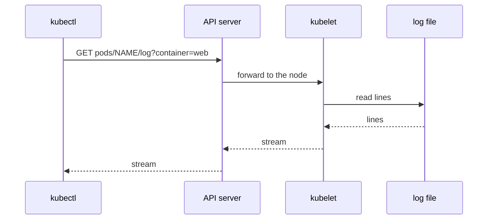

# Choosing The Container And The Pod

The Deployment `multi` runs three pods, and each pod runs two containers named `web` and `worker`. That makes six separate logs. A command that prints "the log of `multi`" has to pick one of them, and the pick is not always the one you need. This part shows how `kubectl logs` picks, and which options let you choose on purpose.

## Where a log request goes

A container log is not stored in the Kubernetes API. The container runtime on the node writes the standard output and standard error of each container to a file, and the kubelet, the agent that runs on every node, owns those files. When you run `kubectl logs`, the request goes to the API server first. The API server checks that you may read the `pods/log` subresource, finds the node that runs the pod and forwards the request to the kubelet on that node. The kubelet reads the file and streams the lines back.



The drawing shows that the kubelet, not the API server, supplies the log lines. If the node is down, `kubectl logs` for a pod on that node fails, even when the pod object still exists.

## Read one pod with one container

Start the playground and list the pods:

<!-- astrona:playground:renew -->

```sh
kubectl -n starfleet get pods -l app=multi
```

The `READY` column shows `2/2` for each pod: two containers, both running. Now print the log of one pod. Replace the pod name with one from your list:

```sh
kubectl -n starfleet logs <POD>
```

The pod has two containers, so `kubectl` has to choose. It prints the log of the first container in the pod, `web`, and writes a notice on standard error that says `Defaulted container "web" out of: web, worker`. The notice is the clue that you read only one of two logs. A pod can name its default container with the annotation `kubectl.kubernetes.io/default-container`; without it, the first container wins.

## Choose a container with -c

The flag `-c` (long form `--container`) names the container. It is the exact answer to "which log do I want":

```sh
kubectl -n starfleet logs <POD> -c worker --tail=5
```

The `worker` container prints a `worker job=N state=done` line every two seconds and a `worker ERROR` line every fifth job. The `web` container prints `web request=N status=200`. An unknown container name fails with an error that lists the valid names, which is a quick way to learn them.

To print every container of the pod, use `--all-containers`:

```sh
kubectl -n starfleet logs <POD> --all-containers --tail=3
```

The lines of one container come first, then the lines of the next. The output does not say which line came from which container, unless the line text says it. The flag `--prefix` fixes that:

```sh
kubectl -n starfleet logs <POD> --all-containers --prefix --tail=3
```

Each line now starts with `[pod/<POD>/web]` or `[pod/<POD>/worker]`. The prefix is the pod name and the container name in one tag, so you can sort or filter the lines later with `grep`.

## Read a Deployment and a label selector

Typing a generated pod name is slow. `kubectl` accepts a resource of the form `deploy/NAME`:

```sh
kubectl -n starfleet logs deploy/multi -c web --tail=3
```

`kubectl` finds the pods that the Deployment selects and reads the log of one of them. It writes `Found 3 pods, using pod/<name>` on standard error. The other two pods are not read. This is the first reason a log command shows "only some" of the output: `deploy/NAME` is a shortcut for one pod.

To read every pod, use the Deployment's label selector with `-l` (long form `--selector`):

```sh
kubectl -n starfleet logs -l app=multi -c web --prefix
```

Now the command reads all three pods. Without `--prefix` you could not tell the pods apart, because the three `web` containers print the same text. With a selector, `-c` must name a container that exists in every selected pod.

## Init containers

An init container runs to completion before the application containers start. Its log stays available after it exits. Save this as `pod-prepare.yaml`:

```yaml
apiVersion: v1
kind: Pod
metadata:
  name: prepare
  namespace: starfleet
spec:
  initContainers:
    - name: setup
      image: docker.io/library/busybox:1.37.0
      command: ["sh", "-c", "echo 'setup step=1 done'"]
  containers:
    - name: main
      image: docker.io/library/busybox:1.37.0
      command: ["sh", "-c", "while true; do echo 'main running'; sleep 5; done"]
```

Apply it:

```sh
kubectl apply -f pod-prepare.yaml
```

Then read the init container by name:

```sh
kubectl -n starfleet logs prepare -c setup
```

The command prints `setup step=1 done`. Plain `kubectl logs prepare` prints the `main` container, and the default-container notice lists `setup (init)` among the names. The flag `--all-containers` includes init containers too. When a pod is stuck in `Init:0/1`, `-c` with the init container name is the way to read why.

This part showed that a log always belongs to one container of one pod, and that `kubectl` picks for you only when you do not say which. What is still open is how many lines come back, from which time, and what happens when the container has already restarted. The next part covers those limits.

## Common pitfalls

> [!WARNING]
> - **Reading the default container by accident.** The notice `Defaulted container` on standard error means a second log exists. Use `-c` or `--all-containers`.
> - **Treating `deploy/NAME` as all pods.** It reads one pod. Use `-l` with the Deployment's label to read all of them.
> - **Using `-c` with a selector when a pod lacks that container.** The command fails for that pod. Check the container names first.
> - **Forgetting `--prefix` on several pods.** Identical lines from different pods look like one stream.
> - **Looking for the init container log under the main name.** Init containers need their own `-c`.
