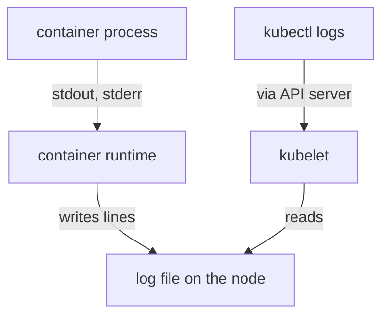

# From Container Output To Node Log Files

An application that prints a line has no idea where the line goes. Kubernetes gives the application no log API: it captures the two output streams of the process and stores them. Knowing the exact path from `echo` to `kubectl logs` explains three facts that surprise many people: a file log is invisible, old lines disappear, and a deleted pod takes its log with it.

## The path of one log line

A container is a process started by the container runtime, a program on the node such as containerd that starts and supervises containers. The process has two output streams: standard output (stdout) and standard error (stderr). The runtime reads both streams and writes each line to a log file on the node. The kubelet, the Kubernetes agent on the node, tells the runtime where to write, rotates the files and reads them back when the API server asks.



The drawing shows that the application, the runtime and the kubelet each do one job. The application writes. The runtime stores. The kubelet serves the stored lines.

## See it work with standard output

The Deployment `stdout-app` runs a loop that prints the time and the text `stdout-event` every three seconds. Read its log:

<!-- astrona:playground:renew -->

```sh
kubectl -n starfleet logs deploy/stdout-app --tail=3
```

Three lines appear, each with a time and `stdout-event`. The runtime captured them from standard output, and the kubelet returned them.

Now read the Deployment `file-app`, whose container appends the same kind of line to `/var/log/app/app.log` and never prints to standard output:

```sh
kubectl -n starfleet logs deploy/file-app
```

The command prints nothing and reports no error. The container is healthy and writing, but the runtime does not look at files inside the container. You can see the file with `kubectl exec`:

```sh
kubectl -n starfleet exec deploy/file-app -- tail -n 3 /var/log/app/app.log
```

This command prints the `file-event` lines. The data exists, but only inside the container filesystem, where the logging path does not reach.

## The log files on the node

The runtime stores each container's log under a directory that the kubelet creates for the pod. The path is `/var/log/pods/<namespace>_<pod name>_<pod uid>/<container name>/<restart count>.log`. The kubelet also creates a symbolic link for each container under `/var/log/containers`, named `<pod name>_<namespace>_<container name>-<container id>.log`. Log collection agents read that second directory because every container has one flat entry there.

You can look at the node with a debug pod. `kubectl debug` creates a pod on the node that mounts the node filesystem at `/host`. First get the node name:

```sh
kubectl get nodes
```

Start a shell on the node, using the busybox image that the playground already holds:

```sh
kubectl debug node/<NODE> -it --image=docker.io/library/busybox:1.37.0
```

Inside the shell, list the pod directories and the links:

```sh
ls /host/var/log/pods
ls -l /host/var/log/containers
```

The first command lists one directory per pod, including `starfleet_stdout-app-...`. The second lists symbolic links that point into the pod directories. Print the end of one `stdout-app` file. The `0.log` file is the first run of the container:

```sh
tail -n 3 /host/var/log/pods/starfleet_stdout-app-*/app/0.log
```

Every line has the same shape: a timestamp, the stream name `stdout` or `stderr`, a tag and the message. The tag is `F` for a full line and `P` for a partial line that the runtime cut because it was very long. This is the Container Runtime Interface (CRI) log format, so the same format appears with any CRI runtime. Leave the shell with `exit`. The debug pod stays in the `default` namespace; delete it with `kubectl delete pod <name>`, where the name was printed when the pod started.

## Rotation

A log file cannot grow without limit, or it would fill the node disk. The kubelet rotates each container's log. Two fields of the kubelet configuration control it:

- `containerLogMaxSize`: the size at which the kubelet rotates the current file. The default is `10Mi`.
- `containerLogMaxFiles`: the number of files the kubelet keeps for one container, including the current one. The default is 5.

When the current file reaches the size limit, the kubelet renames it with a timestamp, the runtime opens a new file, and the oldest file is deleted when the count is exceeded. `kubectl logs` returns only the current file. A busy container can therefore lose its oldest lines within minutes, and `--since=24h` cannot recover lines that rotation has deleted. Changing these fields means editing the kubelet configuration on the node and restarting the kubelet, which is a cluster administrator task and not an application setting.

## When a log is lost

The kubelet owns the log files, so their lifetime follows the objects they belong to. The log of a container survives a restart of that container: the next run writes a new file, and `--previous` reads the last ended run. The log does not survive deletion of the pod. When you delete a pod, or a Deployment replaces it during a rollout, the kubelet removes the pod directory. The same happens when the node is removed. Try it on the `stdout-app` pod:

```sh
kubectl -n starfleet get pods -l app=stdout-app
kubectl -n starfleet delete pod -l app=stdout-app
kubectl -n starfleet logs deploy/stdout-app --tail=2
```

The Deployment creates a new pod with a new name. The log you read now starts at the new pod's first line, and the earlier lines cannot be read through Kubernetes. A cluster that needs history after a pod is gone must copy the logs off the node while the pod runs. That is the topic of the next part.

You now know that a log line travels from the process to a runtime file and out through the kubelet, that only the two standard streams take part, and that rotation and pod deletion remove lines. The open question is what to do when an application insists on writing a file, or when the logs must outlive the pod.

## Common pitfalls

> [!WARNING]
> - **Expecting `kubectl logs` to show a log file.** Only standard output and standard error are captured.
> - **Confusing restart with replacement.** A restart keeps `--previous`. A deleted or replaced pod loses its log.
> - **Relying on `--since` for old data.** Rotation can delete the old lines before you ask.
> - **Treating the node files as a permanent store.** The kubelet deletes them with the pod.
> - **Leaving the debug pod behind.** `kubectl debug node/...` creates a pod that stays until you delete it.
