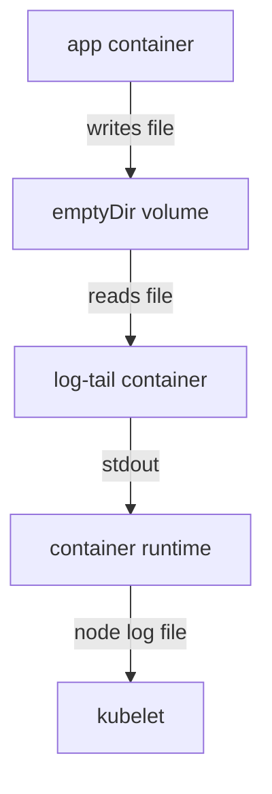

# Node-Level Logging And The Sidecar Pattern

Some applications write their log to a file and cannot be changed to print to standard output. Other teams must keep logs after a pod is deleted. Kubernetes handles both needs with patterns that you build around the pod. This part compares the two common patterns, node-level logging and the sidecar pattern, and then builds a streaming sidecar from the pieces the playground already runs.

## Two patterns

In node-level logging, a logging agent runs on every node, usually as a DaemonSet (a workload that runs one pod on each node). The agent reads the files under `/var/log/containers` and sends the lines to a central store. Applications only have to print to standard output and standard error. The pods need no change, and the logs outlive the pods, because the agent copied them before the kubelet deleted the files. The limit is that the agent sees only what the runtime captured.

In the sidecar pattern, an extra container runs in the same pod as the application. A sidecar is a helper container that shares the pod's volumes and network namespace with the main container. For logging, the sidecar reads what the application writes and makes it visible somewhere else. A streaming sidecar reads a log file and prints it to its own standard output. A shipping sidecar reads the file and sends it directly to a store.



The drawing shows that the sidecar turns a file into standard output, so the normal logging path and node-level agents work again.

## The file is invisible from outside

Containers in one pod do not share a filesystem. Each container has its own root filesystem from its image. A file the application writes at `/var/log/app/app.log` does not exist in the sidecar container, even though both run in one pod. The two containers need a volume that both mount.

The simplest volume for this is `emptyDir`. Kubernetes creates an `emptyDir` volume empty when the pod starts on a node, and every container of the pod can mount it. It lives as long as the pod: it survives a container restart, and the kubelet deletes it with the pod. That lifetime fits a log that is read while it is written.

## Read the playground sidecar

The Deployment `sidecar-app` has two containers, `app` and `log-tail`, and a volume named `logs` of type `emptyDir`. The `app` container appends `sidecar-event` lines to `/var/log/app/app.log`. The `log-tail` container mounts the same volume at the same path and runs this command:

```sh
touch /var/log/app/app.log; tail -n+1 -F /var/log/app/app.log
```

The command creates the file if it is missing, then `tail -n+1` starts at the first line and `-F` keeps following the file even if it is renamed or recreated. Check the pod and read both logs:

<!-- astrona:playground:renew -->

```sh
kubectl -n starfleet get pods -l app=sidecar-app
kubectl -n starfleet logs deploy/sidecar-app -c app
kubectl -n starfleet logs deploy/sidecar-app -c log-tail --tail=3
```

The pod shows `2/2` ready. The `app` container prints nothing, as `file-app` did, because it writes only to the file. The `log-tail` container prints the `sidecar-event` lines. The sidecar did not copy anything over the network: the application and the sidecar read and write one shared directory.

Confirm that the volume is the link between them:

```sh
kubectl -n starfleet get deployment sidecar-app -o jsonpath='{.spec.template.spec.volumes}{"\n"}'
kubectl -n starfleet exec deploy/sidecar-app -c log-tail -- tail -n 2 /var/log/app/app.log
```

The first command prints the `logs` volume with an empty `emptyDir`. The second reads the file from the sidecar's own filesystem view, which works only because the mount exists.

## Write the sidecar yourself

To apply the pattern to a Deployment, three changes are needed in the pod template: add the volume, mount it in the application container and add the sidecar that mounts it too. The sidecar only needs to read, so it can mount the volume read-only with `readOnly: true`. Save this as `deployment-orders.yaml`:

```yaml
apiVersion: apps/v1
kind: Deployment
metadata:
  name: orders
  namespace: starfleet
spec:
  replicas: 1
  selector:
    matchLabels:
      app: orders
  template:
    metadata:
      labels:
        app: orders
    spec:
      containers:
        - name: writer
          image: docker.io/library/busybox:1.37.0
          command:
            - sh
            - -c
            - 'mkdir -p /var/log/app; while true; do echo "$(date +%T) order-event" >> /var/log/app/app.log; sleep 3; done'
          volumeMounts:
            - name: logs
              mountPath: /var/log/app
        - name: log-tail
          image: docker.io/library/busybox:1.37.0
          command: ["sh", "-c", "tail -n+1 -F /var/log/app/app.log"]
          volumeMounts:
            - name: logs
              mountPath: /var/log/app
              readOnly: true
      volumes:
        - name: logs
          emptyDir: {}
```

Apply it:

```sh
kubectl apply -f deployment-orders.yaml
```

Then check the result:

```sh
kubectl -n starfleet rollout status deployment/orders
kubectl -n starfleet logs deploy/orders -c log-tail --tail=3
```

The sidecar prints `order-event` lines. The sidecar's `tail -F` waits for the file when it does not exist yet, so the start order of the two containers does not matter.

## Choosing a pattern

The streaming sidecar has costs. Every line is stored twice on the node, once in the volume and once in the runtime log file, and the sidecar uses CPU and memory in every pod. The `emptyDir` file also grows with no rotation unless the application rotates it. Use the pattern when the application cannot print to standard output, and prefer standard output when you control the code. Node-level logging stays the base for retention, since it works for every pod with no change to the pod.

Since Kubernetes 1.33, a sidecar can also be declared as an init container with `restartPolicy: Always`. The kubelet then starts it before the application container and keeps it running for the life of the pod. The volume and the `tail` command work the same way.

This part showed how a file log becomes a normal container log with a shared volume and a sidecar, and where each pattern fits. What the sidecar cannot do is keep the log after the pod is deleted: for that, a node agent or a shipping sidecar must send the lines elsewhere.

## Common pitfalls

> [!WARNING]
> - **Mounting the volume in only one container.** The sidecar then sees an empty or missing directory.
> - **Using a different mount path in the two containers without adjusting the command.** The `tail` command must read the path where the sidecar mounts the volume.
> - **Using `tail -f` instead of `tail -F` after rotation.** `-f` stops following a renamed file.
> - **Expecting `-c` to be optional.** With two containers, `kubectl logs` defaults to the first one. Name `log-tail`.
> - **Expecting the `emptyDir` log to survive pod deletion.** The kubelet deletes the volume with the pod.
