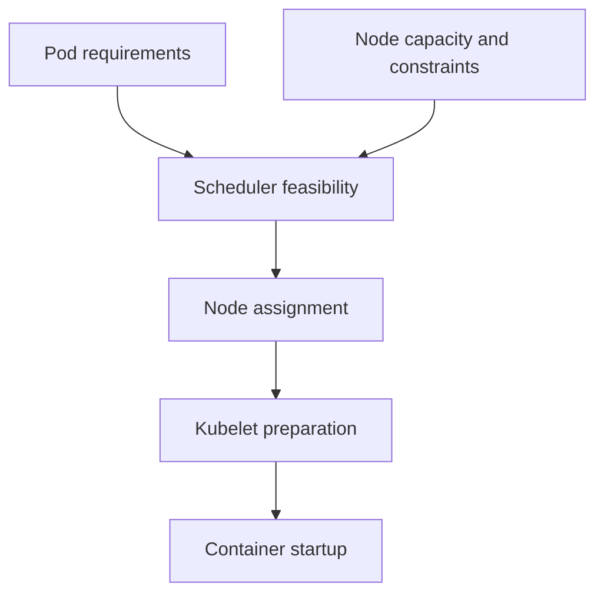

# Placement And Dependency Evidence

A `probe` Pod is Pending because no node can satisfy its declared request and placement rules. Application logs cannot explain a process that has not started. Scheduling status and events identify this earlier boundary.

## Learning objectives

- Distinguish missing node placement from later container preparation.
- Explain how requests and placement constraints interact.
- Choose evidence for an unresolved scheduling dependency.

## Before you start

Use a shell on your own machine with the module playground running. A Pod is Kubernetes's unit for running one or more containers together. The environment provides the `probe` Deployment, which maintains application Pods, and the `starfleet` namespace, which groups these objects.

Read-only commands below use kubectl, the Kubernetes command-line tool. Select the private kubeconfig: the file that identifies this environment's cluster and credentials. The commands do not change the application.

## Placement and Dependency Evidence

The `scout` workload is unavailable, and its Pod is Pending. That observation is a starting point, not a diagnosis. Troubleshooting means forming an explanation from evidence, making a focused correction and checking whether the expected behavior returns.

Read desired state, observed state and timing together. A controller may not have created the requested replicas yet. A created Pod may not have a node assignment. An assigned Pod may still be waiting for an image, a volume or initialization. Each stage has different responsible components and dependencies.

Events can expose a scheduler's failed placement decision. Insufficient requested resources, unmatched affinity and untolerated taints are distinct reasons that need distinct remedies. Removing all placement controls may make a Pod run while violating the original operating requirement, so a fix must preserve the intended behavior.

A missing or unbound persistent claim can also block progress. Storage binding and scheduling can depend on each other when provisioning waits for a suitable consumer location. That relationship is different from a registry authentication problem, even though both can keep an application from starting.

Conditions add structured detail, while container waiting reasons describe preparation or execution state. Events are time-sensitive and may expire or aggregate repeated occurrences. Compare their timestamps with the latest change rather than treating an old failure as the current explanation.

A useful diagnostic sequence narrows the stage before changing settings: confirm the target object and namespace, inspect the controlling workload, check placement, then check startup dependencies. If no node can satisfy a required condition, application logs cannot explain a process that has never run.

## Comparing Three Pending Scenarios

In the first scenario, `scout` requests more memory than any eligible node can provide. Scheduling events report insufficient resources and the Pod lacks an assignment. The relevant correction is capacity or justified sizing. Application log changes cannot explain a process that never started.

In the second scenario, a required node label is absent. A large unlabelled node does not help because resource capacity is not the failed condition. Creating a suitable node or correcting an unintended selector can address the requirement. Removing a necessary hardware rule merely to make the status change would produce an unsuitable placement.

In the third scenario, a storage claim waits for provisioning or a compatible placement. Storage binding mode and topology can link the claim to scheduling. A Pending claim under delayed binding may be expected before a consumer exists, while provisioning errors identify a different failure. Read the relationship before treating all Pending objects as identical.

## Evidence Timing And Controller Intent

Events may describe an older revision of the workload. If a selector was corrected ten minutes ago, an earlier mismatch event is not sufficient evidence that the current template is still wrong. Compare object generation, current fields, event timestamps and newly created Pods.

Likewise, the controller's desired count can be correct while its children fail at later stages. A Deployment requesting three replicas can own three Pods, all without suitable node assignments. Object creation succeeded; availability did not. The failure belongs to the next required transition.

A focused hypothesis states what cannot proceed and why. It predicts a specific observation, such as no assignment and a resource shortage, rather than simply naming a status category. The correction should remove that supported cause while preserving intended permissions, placement and data requirements. Verification then checks both progress at the failed stage and eventual usable capacity.

## Inspect the mechanism

The scheduler selects a feasible node using requests, selectors, affinity, taints and other supported constraints. A resource request expresses capacity needed for placement; a toleration permits a matching taint but does not force placement on that node. Compatible storage topology can impose another requirement.

After a node is selected, the kubelet still needs to prepare volumes, images and containers. Therefore Pending is not a complete diagnosis: read nodeName, conditions and events to determine which stage is waiting. A placed Pod with an image pull problem needs different evidence from a Pod for which no node is feasible.



Placement precedes preparation, so the last completed stage selects the next useful evidence.

<!-- astrona:playground:renew -->

Select the private cluster connection and inspect the live state from your host shell:

```sh
export KUBECONFIG="$(astrona kubeconfig ats-028-playground-050-01)"
if test "$(kubectl config current-context)" = "kind-astro-ats-028-playground-050-01"; then
  kubectl -n starfleet get pods -l app=probe -o wide
  kubectl -n starfleet describe pods -l app=probe
  kubectl get nodes -o custom-columns=NAME:.metadata.name,TAINTS:.spec.taints
else
  printf "Select this module's private kubeconfig before continuing.\n" >&2
fi
```

Compare node assignment with scheduling conditions and event messages. The baseline is scheduled, so it supplies a working example of placement evidence rather than a fabricated FailedScheduling event. `-o wide` adds the assigned node. A toleration or extra node capacity solves only the constraint it actually changes.

You can now classify a waiting Pod before investigating its application. Correct the unmet placement or dependency requirement rather than changing settings that act only after startup.

## Common pitfalls

> [!WARNING]
> Pending has several possible causes. Use placement and dependency evidence rather than assuming every Pending Pod needs more nodes.
