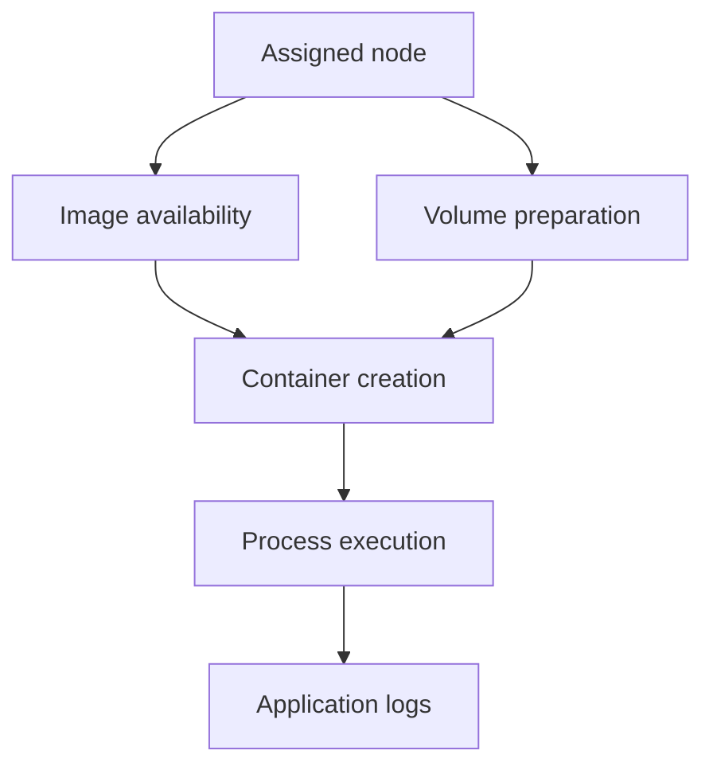

# Image Preparation And Container Startup

The Pod has a node, but its image cannot be retrieved or its mounted configuration is missing. The application has not reached execution yet. Separate preparation failures from process failures to choose the correct evidence.

## Learning objectives

- Distinguish image retrieval, volume preparation and process startup.
- Interpret waiting and terminated container states.
- Explain why application logs may not exist before startup.

## Before you start

Use a shell on your own machine with the module playground running. A Pod is Kubernetes's unit for running one or more containers together. The environment provides the `probe` Deployment, which maintains application Pods, and the `starfleet` namespace, which groups these objects.

Read-only commands below use kubectl, the Kubernetes command-line tool. Select the private kubeconfig: the file that identifies this environment's cluster and credentials. The commands do not change the application.

## Image Preparation and Container Startup

The `scout` Pod has a node assignment, but its container has not started. An image pull error means the runtime cannot obtain the selected artifact. A startup error means it obtained enough of the artifact to attempt execution but could not start the process correctly. A crash means a started process later terminated.

For image preparation, examine the reference, registry response, credentials, network path and platform compatibility. `ImagePullBackOff` describes delayed retry behavior after pull failures. It does not identify whether the underlying problem is a missing tag, authentication or another dependency.

For startup, inspect command and arguments, executable availability, file permissions and required configuration. A mount failure may stop preparation before the application runs. If the application started and exited, its logs, exit code and termination reason become relevant evidence.

`CrashLoopBackOff` means repeated restarts are being delayed. The reason for the first or previous termination remains essential. A memory-limit termination differs from a process exiting because its database setting is missing. Increasing the restart rate would not resolve either root cause.

Some failures belong to regular init containers, which gate application startup. A successful main application image pull does not help if initialization keeps failing. Always identify the affected container rather than assuming all status information belongs to the primary application.

After a correction, check the stage that failed and the final user-facing behavior. A new successful pull proves only artifact access. A Running state proves more execution progress, while readiness and a representative request show whether the application can actually serve its intended work.

## Separating Preparation From Application Execution

A wrong registry tag prevents artifact retrieval. A missing executable prevents process creation after retrieval. An application that rejects a configuration value starts far enough to evaluate its inputs and then exits. These failures can all prevent readiness, but they occur at different boundaries and provide different evidence.

For a pull failure, read the exact reference and runtime response. For an execution failure, inspect the selected command, image filesystem and permissions. For an application exit, inspect logs, exit details and effective configuration. A missing mount can interrupt preparation before any of these process observations exist.

Regular init containers add another boundary. If initialization fails, the main application may have no logs because it never began. A helper's termination reason should not be attributed to the main process. Container names and ordering are part of the diagnostic evidence.

## A Focused Correction And Its Verification

Suppose a private-registry credential is invalid. Replacing it should first allow image retrieval. Then the container must start, become ready and serve the intended behavior. The first successful transition does not establish the last. If startup now fails because another setting is absent, that is a newly visible later dependency rather than proof that the registry fix was irrelevant.

Backoff timing can delay visible recovery. Repeated failures cause retry delays, so a changed dependency does not imply an instantaneous new attempt. Observe current status and the next relevant attempt instead of interpreting a lingering waiting reason as conclusive evidence that the correction failed.

Record the cause and the evidence that changed after the correction. This distinguishes a real repair from a coincidental restart or temporary disappearance. A stable diagnosis identifies the component, failed contract and verification result, which can guide a future check before the same bad configuration is released again.

## Inspect the mechanism

The kubelet coordinates image availability, volumes and container creation through the runtime and storage integrations. A registry rejection happens before the process reads its environment. A missing non-optional ConfigMap can also prevent startup, while an init container can block ordinary application containers after it starts.

Read the waiting reason with events and the desired references. `ImagePullBackOff` describes delayed retries after image retrieval failed. A container that starts and immediately exits crosses a later boundary and can supply terminated state and logs. Moving these failures into one category hides which component can resolve them.



Application logs belong to execution, while earlier preparation failures need kubelet and runtime evidence.

<!-- astrona:playground:renew -->

Select the private cluster connection and inspect the live state from your host shell:

```sh
export KUBECONFIG="$(astrona kubeconfig ats-028-playground-050-01)"
if test "$(kubectl config current-context)" = "kind-astro-ats-028-playground-050-01"; then
  kubectl -n starfleet get pods -l app=probe -o jsonpath='{range .items[*]}{.metadata.name}{" "}{.status.containerStatuses[*].state}{"\n"}{end}'
  kubectl -n starfleet describe pods -l app=probe
else
  printf "Select this module's private kubeconfig before continuing.\n" >&2
fi
```

Identify whether each container is waiting, running or terminated, then correlate the relevant events with its references. The fixture normally reports running state. Do not read an empty waiting field as proof that every historical preparation step succeeded without delay. A log request is useful only after the target process emitted records through the supported path.

You can now identify the last successful startup stage and its responsible component. A corrected dependency permits progress but does not automatically establish process health or application readiness.

## Common pitfalls

> [!WARNING]
> Backoff is a response to repeated failure, not the root cause. An image pull error, an execution error and a process crash require different evidence.
