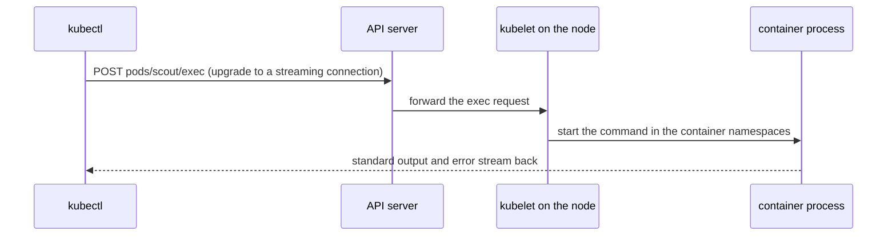

# Running Commands And Tunnels With exec And port-forward

Status, events and logs describe a pod from the outside. When they do not explain a failure, the next step is to look from the inside: which environment variables the process received, which files it can read and which ports it listens on. `kubectl exec` runs a command inside a running container, and `kubectl port-forward` lets your own tools talk to a pod port. Both commands are routed through the API server, so they work from any machine that can reach the API server, even when the pod network is not reachable.

## What exec does

The pod `scout` runs a small web server. Open the playground and run one command in its container:

<!-- astrona:playground:renew -->

```sh
kubectl -n starfleet exec scout -- printenv APP_VERSION
```

The pod specification sets `APP_VERSION` to `2.4.1`, and the command prints that value. The two dashes end the options of `kubectl`. Everything after them is the command and its arguments, and `kubectl` does not interpret them.



`kubectl` sends a request for the `exec` subresource of the pod. The API server checks that your identity may create `pods/exec`, then forwards the request to the kubelet on the node that runs the pod. The kubelet asks the container runtime to start the command inside the container. The output returns on the same connection.

## Reading the inside of a container

Environment variables are the first thing to check, because a wrong value often explains wrong behavior:

```sh
kubectl -n starfleet exec scout -- env
```

The list contains the variables from the pod specification and the `KUBERNETES_SERVICE_*` variables that Kubernetes adds for the Services that exist in the namespace.

To see which ports the process listens on, ask the network stack of the container. The image of `scout` is `python:3.13-alpine`, which includes the BusyBox tools:

```sh
kubectl -n starfleet exec scout -- netstat -tln
```

The output has one line per listening TCP socket. A line with state `LISTEN` and local address `0.0.0.0:9090` means the process accepts connections on port 9090. This is the fact that matters, because the pod specification says something else: it declares `containerPort: 8080`. The `containerPort` field only documents a port. Kubernetes does not check it against the process and does not open or close ports because of it.

You can also request the application directly from inside the container:

```sh
kubectl -n starfleet exec scout -- wget -qO- http://127.0.0.1:9090
kubectl -n starfleet exec scout -- wget -qO- -T 3 http://127.0.0.1:8080
```

The first request returns an HTML directory listing from the Python web server. The second request fails after the timeout, because nothing listens on port 8080.

## Choosing the container and the terminal

A pod can have several containers. Use `-c NAME` to select one. Without `-c`, `kubectl` uses the container named in the annotation `kubectl.kubernetes.io/default-container`, or the first container, and prints a line that says which one it chose.

For an interactive shell add `-i` (keep standard input open) and `-t` (allocate a terminal):

```sh
kubectl -n starfleet exec -it scout -- sh
```

Type `exit` to leave. An interactive session is useful for exploration, but a single command with a clear output is easier to repeat and to paste into a ticket. Exam tasks usually need only single commands.

## When the command does not exist

`exec` runs a program that is already in the container image. A minimal image, such as a distroless image or an image built `FROM scratch`, has no shell and no `ls`. In that case `kubectl exec` fails with an error from the container runtime that the executable file was not found. The fix is not to install tools into a running container. Attach an ephemeral container that brings the tools, which the next part explains.

## Tunnels with port-forward

`kubectl port-forward` opens a listening port on your machine and sends each connection to a port in the pod:

```sh
kubectl -n starfleet port-forward pod/scout 8081:9090
```

The format is `LOCAL:REMOTE`. The command stays in the foreground. In a second terminal request the local port:

```sh
curl -s http://127.0.0.1:8081
```

The reply is the same directory listing that the process returns inside the pod. Stop the tunnel with `Ctrl+C`.

The path is the same as for `exec`: your connection goes to `kubectl`, then to the API server, to the kubelet and finally into the network namespace of the pod. Two facts follow. First, a forward to a pod does not use the Service object for routing, so it works even when the Service is broken. Second, a forward to `svc/scout` or `deploy/scout` picks one pod when the command starts. It does not balance traffic, and it ends if that pod is replaced.

```sh
kubectl -n starfleet port-forward svc/scout 8082:80
```

For a Service, the remote port is the Service port, and `kubectl` translates it to the `targetPort` of the chosen pod. With the faulty Service, `kubectl` reads the Service, resolves the `targetPort` 8080 and forwards to that port of the chosen pod. The local port opens, but each request fails, because nothing listens on port 8080 in the pod. The tunnel to `pod/scout` on 9090 works. Comparing the two results locates the fault in the Service definition and not in the application.

## Putting the observations together

The environment shows `APP_VERSION=2.4.1`. The socket list shows port 9090. The pod specification declares port 8080, and the Service `scout` sends traffic to the target port 8080. Three observations agree that the application is healthy and the Service points at the wrong port. You have not changed anything yet, and each claim comes from a command you can repeat. The open question is how to inspect a container that has no tools, and how to move files in and out.

## Common pitfalls

- Forgetting `--` before the command. Options such as `-it` after the pod name can then be taken by the wrong side.
- Reading `containerPort` as proof that the process listens there. Only a socket list or a successful request from inside proves it.
- Leaving `kubectl port-forward` running in a terminal and forgetting about it. It keeps the pod target until you stop it.
- Using `port-forward` to test a Service and concluding that the Service is fine. A forward to a pod does not test the Service.
- Pasting secrets from `env` output into tickets. `exec env` prints every variable, including values from Secrets.
