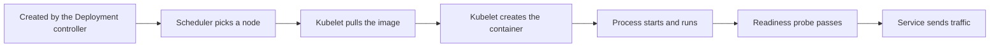

# Reading Status And Events To Find The Failed Stage

When an application does not work, the temptation is to change something and see what happens. Each change then adds noise to the evidence. A pod is created by a chain of components, and each component records what it did, so the status of a failing pod already says which link in the chain broke. Reading it first is faster than guessing and keeps the correction small. This part names the stages, shows where each reports its result and walks through three faults: an unschedulable pod, a bad image and a missing configuration key.

## The stages of a pod



Each box is done by a component that can fail on its own. The scheduler writes the `PodScheduled` condition. The kubelet writes the container state in `status.containerStatuses` and the events for pull, create and start. The endpoints controller adds only ready pods to the Service endpoints. A pod can never reach a later box when an earlier one failed, so you look for the first failure.

Open the playground and list the pods:

<!-- astrona:playground:renew -->

```sh
kubectl -n starfleet get pods
```

The `READY` column shows ready containers against total containers. The `STATUS` column shows the pod phase or, for a container that waits or has stopped, the reason: `Pending`, `ImagePullBackOff`, `ErrImagePull`, `CreateContainerConfigError`, `CrashLoopBackOff`, `OOMKilled` or `Running`. The `RESTARTS` column counts container restarts.

## Pending: the scheduler has not placed the pod

The pod of `captain` has no node. Describe it and read the end of the output:

```sh
kubectl -n starfleet describe pod -l app=captain
```

The `Events` section contains a `FailedScheduling` event from `default-scheduler`. Its message says that zero of the available nodes match, and gives a reason such as `Insufficient cpu`. The `Conditions` section shows `PodScheduled` with status `False` and the reason `Unschedulable`.

The reason is in the resource request. The scheduler adds the `requests` of all containers of a pod and looks for a node whose allocatable capacity, minus the requests of pods already there, covers the total. Compare the request with the node:

```sh
kubectl -n starfleet get deployment captain -o jsonpath='{.spec.template.spec.containers[0].resources}{"\n"}'
kubectl get nodes -o jsonpath='{.items[0].status.allocatable}{"\n"}'
```

The first command prints a CPU request of 64 cores. The second prints the allocatable CPU of the single node. No node has 64 cores free, so the pod stays `Pending` until the request is reduced. Other causes of `Pending` leave different messages: a node selector that no node matches, a taint that the pod does not tolerate or a volume claim that cannot be bound.

## ErrImagePull and ImagePullBackOff: the image cannot be pulled

The pod of `ensign` has a node but the status shows `ErrImagePull`, later `ImagePullBackOff`:

```sh
kubectl -n starfleet get pods -l app=ensign
kubectl -n starfleet describe pod -l app=ensign
```

The events show `Pulling image`, then `Failed to pull image` with the registry error, then `Back-off pulling image`. `ErrImagePull` is the failed attempt. `ImagePullBackOff` is the waiting time before the next attempt, which grows up to five minutes. Both are the same fault. Read the image name in the message: the tag `1.37.99` does not exist for `busybox`, so the registry answers that the manifest is unknown.

The correction is a valid image reference. A restart, a scale change or a new request limit does not help, because every new pod uses the same reference. Setting the image in the Deployment creates a new ReplicaSet with working pods:

```sh
kubectl -n starfleet set image deployment/ensign main=docker.io/library/busybox:1.37.0
```

## CreateContainerConfigError: the container cannot be built

The pod of `cadet` has an image but the status is `CreateContainerConfigError`. The kubelet builds the container specification before it starts the process. The container reads the variable `MODE` from the key `mode` of the ConfigMap `cadet-settings`:

```sh
kubectl -n starfleet describe pod -l app=cadet
kubectl -n starfleet get configmap cadet-settings
```

The event says that the ConfigMap `cadet-settings` was not found, and the second command confirms it with a `NotFound` error. The process has never started, so there are no logs; `kubectl logs` would only report that the container is waiting. The correction is to create the ConfigMap with the key that the pod expects:

```sh
kubectl -n starfleet create configmap cadet-settings --from-literal=mode=patrol
```

The kubelet retries on its own, so a new pod is not required. After a short time the pod becomes `Running`. If the ConfigMap exists but the key is wrong, the error message names the missing key instead.

## Using the evidence in order

In all three cases the same three steps worked. The status column named the stage. The events of that stage gave the exact reason, and one object was changed to remove it. Describe output is long, so read the `Conditions` and `Events` sections first, and the container `State` and `Last State` blocks next. Fields of the pod specification are the last place to look, because they only show what was asked for.

Two of the five faulty workloads are not covered yet. One starts and is then stopped, and one runs without receiving traffic. Their evidence appears after the process starts, in the exit code and in the endpoints of a Service.

## Common pitfalls

- Treating `ImagePullBackOff` as a network problem before reading the registry message. A wrong tag is more common than a network failure.
- Running `kubectl logs` on a pod whose container never started. There is nothing to read, and the answer is in `describe`.
- Deleting the pod to fix a Deployment fault. The Deployment creates an identical pod with the same fault.
- Reducing a request without checking the real need. A request that is too small lets the pod start and then fail at runtime.
- Reading only the first lines of `describe`. The reasons are at the end, in `Events`.
